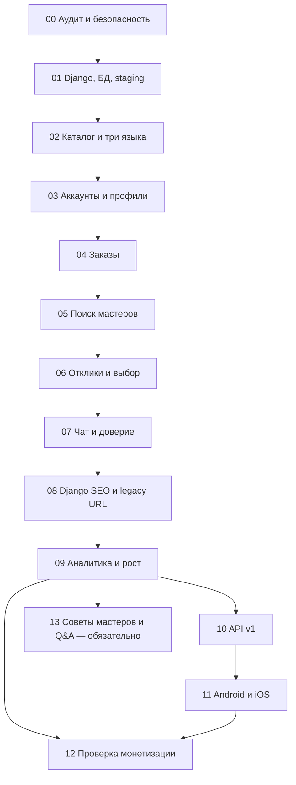

# ZemiPro — дорожная карта разработки и запуска

> **Версия:** 1.3.11
> **Базовая дата:** 2026-11-05  
> **Статус:** рабочая дорожная карта, не свидетельство завершения этапов  
> **Горизонт:** бессрочно; без фиксированных дедлайнов  
> **Файл для GitHub:** `docs/ROADMAP.md`  
> **Синхронизировано с:** `docs/TECHNICAL_SPEC.md`, `docs/DEVELOPMENT_PLAN.md`, `docs/MARKETING_STRATEGY.md`  
> **Рынок:** Израиль; три языка `ru/en/he`; веб на Django → Android и iOS

## 1. Цель и неизменные договорённости

Разработать **ZemiPro**, многоязычный универсальный маркетплейс услуг Израиля по механике [Profi.ru](https://profi.ru/): заказчик публикует задачу **или** сам ищет специалиста; мастер откликается; стороны договариваются, ведут переписку, завершают заказ и оставляют честный отзыв. Речь о собственном дизайне, коде и бренде, без копирования материалов Profi.ru.

- **Основа:** единый Django + PostgreSQL (`zemipro_web/`). Старый Telegram runtime удалён из ветки этапа 00; PSEO-репозиторий удалён владельцем. Не переносить legacy базы/код/контент, только проверять старые URL.
- **Продуктовый охват:** все основные категории услуг с возможностью расширять каталог без изменений ядра; **первый публичный пилот и привлечение пользователей — только город Ашдод**. Другие города — только после отдельного решения владельца. Долгосрочная архитектура поддерживает весь Израиль.
- **Языки:** русский, английский, иврит; корректный RTL, мультиязычное SEO, возможность AI-перевода с указанием происхождения.
- **Регистрация специалистов:** без обязательной проверки лицензий/сертификатов платформой; не выдавать неподтверждённые статусы. Соблюдение применимого законодательства обязательно.
- **Деньги:** заказчику бесплатно; базовая работа исполнителя бесплатна при запуске; эксперименты с оплатой платформы — после доказанного спроса. ZemiPro не хранит оплату самих услуг в начальной модели.
- **Продвижение:** в первую очередь Facebook и SEO, автоматизация разрешённых операций, без обязательных затрат на рекламу и нежелательных массовых сообщений.
- **Приложения:** Android и iOS работают через общий Django API и ту же PostgreSQL, после стабилизации веб-платформы.

## 2. Исходники и документы — изучать до начала работ

| Приоритет | Источник | Назначение |
|---|---|---|
| 1 | [Основной Django](https://github.com/maxim9362/zemiPro_site_django) | Единственный репозиторий разработки, код `zemipro_web/`. Старый Telegram runtime убран из `stage-00-audit` |
| 2 | PSEO удалён (исторический источник) | Репозиторий удалён 2026-11-10, API GitHub вернул 404; не использовать для нового кода/данных. Остался `docs/SEO_URL_INVENTORY.csv` |
| 3 | [Публичный ZemiPro](https://zemipro.co.il/) | Живые адреса страниц, редиректы, текущее поведение, индексация |
| 4 | [Profi.ru](https://profi.ru/) | Только референс сценариев, функций и UX: каталог, анкеты, заказы, предложения, чаты, отзывы |
| 5 | `docs/TECHNICAL_SPEC.md` | Источник обязательных продуктовых и технических требований (`REQ-*`) |
| 6 | `docs/DEVELOPMENT_PLAN.md` | Детальные задачи, тесты и критерии всех 96 подэтапов |
| 7 | `docs/MARKETING_STRATEGY.md` | Постоянные правила маркетинга, метрики и порядок их изменения |

**Важно:** в истории legacy-кода обнаружены потенциально чувствительные файлы и секреты. Не переносить `.env`, сервисные ключи и прокси-учётные данные в новые коммиты/логи. Потенциально раскрытые секреты подлежат отзыву у провайдеров. Старый PSEO не переносится: сохраняется только реестр подтверждаемых URL, а данные и индексация проверяются фактически. Текущая маркетинговая стратегия ориентирована на бытовые услуги; по мере выхода во все категории корректировать её отдельным решением.

## 3. Легенда статусов и исходный срез

| Статус | Значение |
|---|---|
| `NOT_STARTED` | Ещё не начинали **работу по новому плану**; старый код может существовать, но готовность не проверена |
| `IN_PROGRESS` | Работа ведётся, DoD ещё не доказан |
| `BLOCKED` | Продолжение невозможно: указать причину и условие разблокировки |
| `REVIEW` | Этапный PR подготовлен; ожидает проверок/решения владельца |
| `DONE` | Критерии, тесты, документация и приёмка подтверждены; этапный PR принят |
| `DEFERRED` | Отложено обоснованным решением, указано влияние на последующие этапы |

**Историческая начальная точка (2026-11-05):** первоначальная программа содержала 13 этапов и 85 подэтапов; на тот момент ни один не был принят. Это историческое число, а не актуальный объём. Наличие legacy Django/Telegram/PSEO-кода не являлось подтверждением готовности.

**Актуальный объём плана (2026-11-11):** все 14 этапов (00–13) и 96 подэтапов обязательны для полного завершения программы. Этап 13 начинается после готовности 09 и команды владельца; публичная активация Q&A требует отдельного `GO`. Ранний MVP и этапы 10–12 могут приниматься независимо.

**Последняя сверка (2026-11-12):** этап 00 — основной аудит принят с открытыми follow-up (PR #6 MERGED); этап 01 — локальная база принята для продолжения (PR #7 MERGED), внешние инфраструктурные гейты остаются; этап 02 — `IN_PROGRESS / ASHDOD_SCOPE_CODEX_REVIEW_PASS / CURRENT_SHA_GITHUB_CI_PENDING / MANUAL_GATES_OPEN`. Независимая проверка выявила и исправила remote-profile bypass (`3a8e9988`); локально подтверждены 13/13 Ashdod-only, 164/164 Django и 180/180 Chromium. Публичный пилот — только Ашдод; 25 записей остаются техническим справочником. Редакторские, физические и инфраструктурные гейты открыты. PR #8 — `Draft / NOT_MERGED`. Число полностью закрытых по всем гейтам этапов — 0.

### Сводный статус этапов

| Этап | Наименование | Подэтапов | Зависит от | Текущий статус | PR |
|---|---|---:|---|---|---|
| `00` | Аудит, безопасность и сохранение активов | 6 | Нет | `CORE_VERIFIED / FOLLOW_UP_REQUIRED` | [#6 — merged](https://github.com/maxim9362/zemiPro_site_django/pull/6) |
| `01` | Стабилизация Django и инфраструктуры | 6 | 00 | `LOCAL_VERIFIED / EXTERNAL_GATES_DEFERRED` | [#7 — merged](https://github.com/maxim9362/zemiPro_site_django/pull/7) |
| `02` | Категории, география, три языка | 6 | 01 | `IN_PROGRESS / ASHDOD_SCOPE_CODEX_REVIEW_PASS / CURRENT_SHA_GITHUB_CI_PENDING / MANUAL_GATES_OPEN` | [#8 — Draft](https://github.com/maxim9362/zemiPro_site_django/pull/8) |
| `03` | Аккаунты, роли и профили | 7 | 02 | `NOT_STARTED / UNVERIFIED` | — |
| `04` | Создание и управление заказами | 7 | 03 | `NOT_STARTED / UNVERIFIED` | — |
| `05` | Поиск специалистов и приглашения | 6 | 04 | `NOT_STARTED / UNVERIFIED` | — |
| `06` | Отклики, предложения и выбор исполнителя | 6 | 05 | `NOT_STARTED / UNVERIFIED` | — |
| `07` | Чат, уведомления, репутация и модерация | 7 | 06 | `NOT_STARTED / UNVERIFIED` | — |
| `08` | Новые Django SEO-страницы и решения по legacy URL | 7 | 07 + инвентарь 00 | `NOT_STARTED / UNVERIFIED` | — |
| `09` | Аналитика и автоматизированный маркетинг | 7 | 08 | `NOT_STARTED / UNVERIFIED` | — |
| `10` | Версионированный API для приложений | 6 | 09 (подготовительные контракты можно раньше) | `NOT_STARTED / UNVERIFIED` | — |
| `11` | Мобильное приложение Android и iOS | 7 | 10 | `NOT_STARTED / UNVERIFIED` | — |
| `12` | Монетизация и долгосрочное развитие | 7 | 09 для гипотез; 11 для полного контура | `NOT_STARTED / UNVERIFIED` | — |
| `13` | Статьи, Q&A, рекомендации и приглашения (обязательный) | 11 | 09 + команда владельца; 10–12 независимы | `NOT_STARTED / UNVERIFIED` | — |
| **Итого** | **14 этапов** | **96** | | **0 этапов закрыто по гейтам** | |

## 4. Порядок и контрольные точки



**Контрольные рубежи (гейты):**

- **G0 — безопасная база (00–01):** аудит, секреты, резервное восстановление, CI/staging; без этого нельзя безопасно менять production.
- **G1 — функциональный маркетплейс (02–07):** оба клиентских сценария, основные функции специалиста, завершение и отзывы, доступность на трёх языках.
- **G2 — публичный Django вместо прежнего сайта (08):** сохранены важные PSEO URL/редиректы, проверены SEO и план отката; **переключение только по разрешению владельца**.
- **G3 — измеряемый рост (09):** реальные заявки, подбор исполнителя, органическая публикация и аналитика эффективности.
- **G4 — стабильный мобильный API (10):** общий API без дублирования бизнес-правил.
- **G5 — приложения (11):** Android/iOS с общими профилями, заказами, сообщениями и проверками.
- **G6 — проверенная коммерческая модель (12):** реальные гипотезы, тесты платежей и управляемое масштабирование; первые исследования монетизации возможны после G3, не дожидаясь приложения.
- **G7 — обязательные знания и рекомендации (13):** после G3 и команды владельца все 11 подэтапов реализуются и проверяются; отдельные `GO` управляют публичной активацией. Ранний MVP и G4–G6 независимы, общий `DONE` программы требует G7.

**Даты:** не задаём вымышленных сроков. Переход происходит после выполнения гейта, а не из-за календаря. При необходимости владелец добавит целевые даты отдельным решением.

## 5. Подробная дорожная карта с 96 подэтапами

**Рабочая отметка:** `[x]` используется только при доказанном выполнении критериев подэтапа; остальные пункты остаются `[ ]` с точным статусом. Обновляются и checkbox, и `docs/PROGRESS.md`; неподтверждённое «готово» запрещено.

### Этап 00. Аудит, безопасность и сохранение активов

- **Зависимость:** Нет.
- **Результат этапа:** Зафиксированы исходный код, данные, опубликованные SEO-URL; риски раскрытых секретов устранены или отмечены как блокер.
- **Гейт закрытия:** Проверенные резервные копии, матрица reuse/adapt/rewrite, инвентарь URL, результаты безопасных диагностик и решение по секретам.
- **Особое условие:** Критический стоп-фактор: не переходить к деплою или копированию данных без проверки секретов и backup.
- **Статус:** `IMPLEMENTED / CORE_VERIFIED / FOLLOW_UP_REQUIRED` · **Ветка:** `stage-00-audit` · **Итоговый PR:** [#6](https://github.com/maxim9362/zemiPro_site_django/pull/6) — `MERGED` 2026-11-11; follow-up 00.2/00.4 не закрыты

- [x] **00.1 — Инвентаризация существующих реализаций.** `DONE / INDEPENDENTLY_VERIFIED`: независимый аудит подтвердил единственный Django runtime и отсутствие runtime-зависимостей от удалённых Telegram/PSEO. Исторические источники не являются поставщиками кода или данных.
- [ ] **00.2 — Аварийная проверка и ротация секретов.** `LEGACY_REMOVED / PROVIDER_REVOCATION_DEFERRED_BY_OWNER`: legacy runtime удалён, старые Gemini/Google/Telegram/SOCKS5 не используются новой платформой. Фактический отзыв не подтверждён; владелец выполнит его позднее. Обязательный production security gate сохранён.
- [ ] **00.3 — Резервные копии и фиксация исходного состояния.** `CORE_VERIFIED / SYNTHETIC_RESTORE_PASS / FRESH_DB_DECIDED`: PostgreSQL 17.11 backup/restore подтвердил равенство 27 миграций, 8 категорий, 56 подкатегорий и 25 городов. Новая Django-БД создаётся с нуля; Telegram/PSEO данные не импортируются. Перед production всё равно требуется backup/restore и rollback новой БД.
- [ ] **00.4 — Инвентаризация опубликованных URL.** `DEFERRED / RETURN_BEFORE_STAGE_08`: сохранён корректный CSV с 21 уникальным URL, но HTTP, sitemap, canonical, GSC и ценность страниц не проверены. Перед началом этапа 08 обязательно завершить проверку и решения KEEP/301/404/410. Сейчас редиректы, сайт, DNS и Cloudflare не изменять.
- [x] **00.5 — Архитектурная согласованность.** `DONE / DOCUMENTED`: ADR-0001/0002/0003, нормативные документы и матрица согласованы с единым Django/PostgreSQL, обязательной авторизацией и запретом импорта Telegram/PSEO. HIGH-риски распределены по будущим этапам.
- [ ] **00.6 — Базовая диагностическая проверка.** `CORE_VERIFIED / FOLLOW_UP_REQUIRED`: 17/17 Django-тестов, 12/12 тестов инструментов, system/deploy checks, миграции, Git checks и synthetic PostgreSQL restore прошли. Docker build не подтверждён из-за Cloud TLS proxy; production не затронут.

**Решение по этапу 00:** активная разработка и основная проверка завершены; статус `IMPLEMENTED / CORE_VERIFIED / FOLLOW_UP_REQUIRED`. Отложенные 00.2 и 00.4 не отменены: security gate обязателен до production, 00.4 обязателен до этапа 08. Это не статус полного `DONE` всех шести подэтапов.

### Этап 01. Стабилизация Django и инфраструктуры

- **Зависимость:** 00.
- **Результат этапа:** Воспроизводимые dev/test/staging, PostgreSQL и миграции, CI, наблюдаемость.
- **Гейт закрытия:** Чистая установка и миграции проходят, тесты проверены, staging работает отдельно от production, восстановление БД воспроизводимо.
- **Особое условие:** Обновление production, DNS и исходной БД требует отдельного разрешения.
- **Статус:** `LOCAL_VERIFIED / ACCEPTED_FOR_STAGE_02 / EXTERNAL_GATES_DEFERRED` · **Ветка:** `stage-01-development` (от `main` `6b119043e330`) · **История:** PR #2 и #6 объединены, итоговый этапный [PR #7](https://github.com/maxim9362/zemiPro_site_django/pull/7) `MERGED` 2026-11-11 (`7202ce1f8f1a`); внешние гейты отложены и не засчитаны как `DONE`

- [ ] **01.1 — Структура конфигурации и окружений.** `IN_PROGRESS / CODE_AND_SETTINGS_TESTS_PASS`: добавлены четыре профиля, строгая проверка секретов/HTTPS, Python 3.12 + Django 5.2 LTS с точными pins, новая инструкция запуска, синтетические конфигурационные тесты и Docker secret exclusions. По отчёту Codex Linux dependencies и settings check PASS; HSTS=0 теперь отклоняется, регрессионные тесты PASS. Windows и реальный secure staging остаются непроверенными; `DONE` не подтверждён.
- [ ] **01.2 — PostgreSQL и миграции.** `IN_PROGRESS / SYNTHETIC_POSTGRES_VERIFIED`: сохранены исходные FK/UNIQUE/индексы, добавлены недеструктивные проверки и CHECK ограничений статусов заказа, отклика и жалобы; тесты PostgreSQL и runbook чистой/восстановленной синтетической БД готовы. По первому отчёту Codex clean/restore migrate, статусы и проверки ограничений PASS на синтетической PostgreSQL; новая `accounts.0003` отдельно PASS по повторной проверке. Никакого импорта Telegram/PSEO.
- [ ] **01.3 — Базовые тесты и CI.** `IN_PROGRESS / RUFF_AND_CI_PASS / BRANCH_PROTECTION_BLOCKED`: добавлены GitHub Actions для изолированной PostgreSQL 17, линтер Ruff, миграционные/system checks, Django TestCase и покрытие критичного сервисного слоя (порог 60%), а также синтетические фабрики и дополнительные негативные тесты. Codex повторно подтвердил Ruff PASS, GitHub Actions PASS, Django tests 75/75 дважды и 89,5% покрытия только `apps.marketplace.services`; required-check branch protection для `main` всё ещё BLOCKED.
- [ ] **01.4 — Docker Compose и staging.** `IN_PROGRESS / DEV_VERIFIED / HTTPS_STAGING_NOT_RUN`: подготовлены отдельные Compose для development/staging на PostgreSQL 17, непубличная staging-БД, постоянные DB/static/media volumes, non-root Django, startup migration gate, healthchecks, лимиты памяти, HTTPS Caddy и запрет прямого `/media/`; staging config требует нового домена/секретов. По отчёту Codex dev Compose/runtime, PostgreSQL persistence и временная Docker сборка с audit CA mount PASS; native build без Cloud proxy CA и HTTPS staging на согласованном отдельном хосте остаются BLOCKED/NOT_RUN.
- [ ] **01.5 — Логи, резервное копирование и восстановление.** `IN_PROGRESS / SYNTHETIC_RESTORE_PASS / OFF_HOST_AND_ALERT_PENDING`: добавлены JSON-логи с allowlist/redaction, health live/ready с 503 при недоступности PostgreSQL, staging backup service (opt-in pg_dump + SHA-256), шаблон ежедневного cron, HTTPS readiness monitor и runbook безопасного synthetic restore/rollback. По отчёту Codex health, redaction, staging backup dump+SHA-256 и synthetic restore parity PASS; реальный off-host backup и доставленный alert не подтверждены. Cron/DNS/VPS запускать только по разрешению.
- [ ] **01.6 — Базовая производительность и доступность.** `IN_PROGRESS / SQL_AND_REGRESSION_TESTS_PASS / BENCHMARK_NOT_RUN`: устранены N+1 в каталоге мастеров и кабинете заказчика, добавлены SQL scaling tests и стабильная пагинация; приватные HTML-ответы no-store, безопасные 404/500, минимальные узкоэкранные CSS-правки и базовый POST throttle входа/регистрации. Codex подтвердил PostgreSQL SQL scaling, общий атомарный лимитер и регрессионные тесты PASS; реальные p50/p95/RSS, 320px/HE RTL и edge/proxy staging checks остаются NOT_RUN.

**Исторический первый Codex-review 2026-11-11 (исправлено):** `CHANGES REQUIRED`; 69/69 исходных Django-тестов и миграции PASS, но Ruff/CI FAIL (16×F401, 2×F405) и найдены ZP-01-001–006. Подготовлены исправления Ruff, HSTS, blocked profiles, NULLS LAST, общей PostgreSQL rate limiter и документации. Новую миграцию и расширенный набор тестов требуется повторно проверить. Staging HTTPS, off-host backup/alert, p95/RSS/RTL и branch protection всё ещё ожидают отдельной проверки и согласований.

**Повторный Codex-review 2026-11-11 по `c8591a553b59412c56c85ab2b2b584b4f5718719`:** `CODE_REVIEW_PASS` — ZP-01-001–006 устранены, Ruff PASS, GitHub Actions PASS, новая `accounts.0003` PASS, 75/75 Django tests дважды, 89,5% покрытия сервиса заказов, атомарный общий rate limiter PASS. Документация обновляется отдельным commit; инфраструктурные проверки (staging HTTPS, off-host backup/alert, branch protection, p95/RSS, mobile HE/RTL) остаются `BLOCKED/NOT_RUN`. PR можно открыть как Draft, **без merge** и без закрытия этапа.

**Изолированная CI smoke-репетиция (2026-11-11):** `Stage 01 isolated staging smoke` [run #1](https://github.com/maxim9362/zemiPro_site_django/actions/runs/43028406371) **PASS** (localhost / internal CA only): HTTP/TLS/health, CSS/media, PostgreSQL restart persistence, synthetic backup SHA256. 100 запросов к пустому каталогу: p50 15.5 мс / p95 16.6 мс — **не реальные staging benchmarks**. Основной Django CI [run #9](https://github.com/maxim9362/zemiPro_site_django/actions/runs/43028406270) **PASS**. Real DNS/TLS staging, off-host backup+alert, mobile RTL, branch protection остаются неподтверждёнными.

**Локальный Codex Windows-review 2026-11-11:** `CHANGES_REQUIRED` на `8365d7c`, несмотря на успешные 75/75 Django tests и изолированные dev/staging/backup/health проверки. Устранены обнаруженные `CRLF` shell scripts (новая `.gitattributes`), отсутствующий Gunicorn HOME и неограниченный размер кабинета клиента (10 заказов/страницу в каждом из 4 статусов). Исправлена динамическая разметка `lang/dir`; полная локализация и визуальный RTL остаются в 02.3. **GitHub CI нового кодового коммита `7e07079` PASS (81/81, Ruff, миграции, сервисное покрытие 89,5%) и isolated staging smoke PASS**; Windows-прогон CRLF, Gunicorn HOME и лимита HTML после пересборки на ноутбуке ещё `NOT_RUN`. Без него нет полной локальной приёмки. Off-host backup, delivered alert, branch protection и real trusted staging TLS остаются внешними гейтами.

**Повторный локальный Codex 2026-11-11 по `7109420`:** Windows LF, Docker rebuild, Gunicorn HOME, 1000 синтетических заказов (HTML 39 661 Б; HTTPS p95 101,79 мс), приватность и lang/dir RU/EN/HE **PASS**; Windows Django 81/81, Ruff и миграции PASS. Только Docker suite 80/81 из-за теста, ожидавшего корневой `.gitattributes` вне Docker build context: исправлена условная проверка наличия, без отключения фактической LF/HOME проверки. **Повторный CI и Docker suite на новом SHA ожидаются**. Внешние off-host backup, доставленные оповещения, GitHub branch protection и publicly trusted staging TLS не подтверждены.

**Решение владельца 2026-11-11 (локальная приёмка / переход на этап 02):** `LOCAL_VERIFIED / ACCEPTED_FOR_STAGE_02`. Рабочие Windows Development/Staging локально проверены Codex на синтетических данных (включая PostgreSQL 17, 30 миграций, 1000 заявок, LF shell scripts, Git checkout, Docker rebuild, Gunicorn HOME, HTTPS localhost, backup/restore, 81/81 тестов в Windows venv). Последний дефект Docker-only test `/.gitattributes` устранён; [Django CI #43079414032](https://github.com/maxim9362/zemiPro_site_django/actions/runs/43079414032) и [staging smoke #43079414024](https://github.com/maxim9362/zemiPro_site_django/actions/runs/43079414024) оба `SUCCESS` на кодовом SHA `455236a`, включая адресный Docker тест `Found 1 test(s) / OK`. Повтор полного suite **именно на Windows** на последнем SHA ещё не предоставлен и не заявляется выполненным. Согласован переход к этапу 02 и merge одного этапного PR #7; это **не** разрешение на выкладку.

**Отложенные обязательства до публичного запуска:** `OFF_HOST_BACKUP_NOT_VERIFIED`, `ALERT_DELIVERY_NOT_VERIFIED`, `BRANCH_PROTECTION_BLOCKED`, публично доверенный staging HTTPS `NOT_RUN`, реальные нагрузки на выделенном хосте/мобильный HE UX до запуска. Эти пункты **не считаются выполненными и не отменяются**; staging/production release требует самостоятельного подтверждения и явного согласования. 02.3 отвечает за полноценные переводы RU/EN/HE и RTL. При приёмке `LOCAL_VERIFIED` 01.1–01.6 могут быть использованы как проверенная локальная база; их внешние гейты остаются открытыми.

**Решение по этапу 01:** закрывать только после выполненных подэтапов (или документированного `DEFERRED` с подтверждением), адресных проверок, необходимых интеграционных тестов и принятия единственного этапного PR.

### Этап 02. Категории, география, три языка

- **Зависимость:** 01.
- **Результат этапа:** единый каталог, технический геосправочник Израиля для будущего расширения и **публичное обслуживание только в Ашдоде** на первом пилоте; RU/EN/HE и RTL.
- **Гейт закрытия (уточнение владельца):** технический тестовый справочник 6 округов / 25 записей городов / 4 алиаса сохраняется ради существующих ID/FK и проверок, но **единственная территория первого публичного пилота — Ашдод**. Перед публичным запуском обязателен проверяемый Ashdod-only gate для каталога, выбора города в формах, создания заказов, поиска/зон обслуживания и прямых/локализованных URL; иные города нельзя выдавать за доступные. Геофильтр реализован в коммитах `43c0b561`/`28133a2f` и CI-verified (11/11 новых тестов, 162/162 общий Django, Chrome 45/45). Независимое ревью нового diff остаётся открытым. Национальный CBS — до общенационального rollout; редакторский HE, реальные устройства, UX, инфраструктура, merge/deploy — отдельные открытые гейты.
- **Особое условие:** Не путать доступность всех категорий в продукте с одновременным продвижением всех категорий.
- **Статус:** `TECHNICAL_IMPLEMENTATION_COMPLETE / ASHDOD_SCOPE_CODEX_REVIEW_PASS / OWNER_APPROVED_RELEASE_GATE_DEFERRAL / CURRENT_SHA_GITHUB_CI_PENDING / PR_DRAFT` · **Ветка:** `stage-02-catalog-localization` (от `main` `7202ce1f8f1a`) · **Итоговый PR:** [Draft #8](https://github.com/maxim9362/zemiPro_site_django/pull/8) — единственный для 02.1–02.6, merge только после 02.6

- [x] **02.1 — Каталог Django (раздел → категория → услуга).** `CODE_DONE / CI_VERIFIED / EDITORIAL_REVIEW_PENDING`: добавлен `ServiceSection` и миграция `marketplace.0005_catalog_hierarchy` без изменения существующих ID/slug, RU/EN/HE имена, описания и SEO-поля, тип работы, Django Admin, группировка публичного каталога. Новый `seed_service_catalog` — 12 разделов по ТЗ, 8 существующих ремонтных категорий с 56 услугами и 11 новых примерных категорий с 32 услугами; 12/19/88 после запуска на изолированной тестовой БД. Повторное выполнение не удаляет данные и не перезаписывает настройки администратора. **Технически проверено:** GitHub Django CI [#43086273717](https://github.com/maxim9362/zemiPro_site_django/actions/runs/43086273717) 92/92 PASS, Ruff PASS, `makemigrations --check` и миграция PASS; изолированный seed первый запуск создал 12/19/88, второй — 0/0/0, `--check` PASS. Docker staging smoke [#43086273848](https://github.com/maxim9362/zemiPro_site_django/actions/runs/43086273848) PASS. **Контент 11 новых категорий и переводы RU/EN/HE — предварительные; финальное редакторское утверждение до публикации сохраняется как `EDITORIAL_REVIEW_PENDING`.**
- [x] **02.2 — География Израиля и зоны обслуживания.** `CODE_DONE / CI_VERIFIED / PILOT_ASHDOD_ONLY_APPROVED / ASHDOD_SCOPE_CI_VERIFIED / NEW_SCOPE_CODEX_REVIEW_PENDING / NATIONAL_CBS_DEFERRED_TO_NATIONWIDE_ROLLOUT`: `District/City/CityAlias` с RU/EN/HE и исходными 25 стабильными городами, безопасный повторяемый seed, служебные зоны нескольких городов для мастера, онлайн-флаг и фильтры каталога/заказов. Существующие ID/slugs сохраняются. Полное расширение государственного справочника на все населённые пункты Израиля **не считается выполненным**; отдельная сверка с CBS и контент-проверка до общенационального запуска. **Подтверждено:** GitHub [Django CI #43090165800](https://github.com/maxim9362/zemiPro_site_django/actions/runs/43090165800) — Ruff, clean migrations, seed 6/25/4 с повтором 0/0/0, **106/106 Django PASS**, целевое service coverage 94,0%; [Docker smoke #43090165776](https://github.com/maxim9362/zemiPro_site_django/actions/runs/43090165776) PASS. Редакторская/официальная сверка полного национального перечня и переводов остаётся открытым гейтом перед полноценным запуском. **Уточнение владельца от 2026-11-12 (заменяет решение о 25 городах):** для первого пилота **разрешён только Ашдод**. Остальные 24 города остаются в техническом seed ради совместимости и будущего расширения, но не утверждены к публикации. До запуска нужно реализовать и проверить ограничение видимости, выбора города, заявок и direct URLs; серверная реализация проверена в CI #43170333703; независимый CodeX-review ожидается. Полный CBS-справочник остаётся обязательным перед общенациональным запуском. Перед пилотом проверить RU/EN/HE именно Ашдода и видимый контент.
- [ ] **02.3 — Интернационализация сайта и RTL.** `CODE_VERIFIED / MOBILE_VISUAL_PENDING / CONTENT_REVIEW_PENDING`: включены переводимые шаблоны Django RU/EN/HE, `.po` и `.mo` для EN/HE, переключатель языка через защищённый Django `set_language` без смены старого URL, локализованные формы и ошибки, JSON для выбора подуслуг, системные уведомления без переписывания сохранённых текстов, логические CSS и переносы для HE RTL. Подтверждено CI на коммите `8d7427d` — 10/10 i18n-тестов PASS, полный набор 125/125 PASS и Docker smoke SUCCESS. Реальные скриншоты 320/360/375/390/768 px и редакторская проверка иврита — обязательны перед релизом; языковые `/ru/`, `/en/`, `/he/` URL относятся к 02.4.
- [x] **02.4 — Локализованные публичные маршруты каталога.** `CODE_DONE / CI_VERIFIED / SEO_INDEXING_GUARD_FIXED`: новые RU/EN/HE маршруты для разделов, категорий, услуг и городов в отдельном namespace; все старые URL продолжают отвечать без 301/308; canonical + hreflang на новых URL, сохраняется один доменный ID/slug; подтверждённые алиасы города перенаправляют только новые языковые URL на канонический slug; пустые/неподтверждённые страницы остаются `noindex`. Индексация новых маршрутов по умолчанию выключена до редакторского и SEO-одобрения. **GitHub CI #43155367524 PASS:** 9/9 целевых URL-тестов, 10/10 тестов 02.3, 125/125 полный Django набор, Ruff PASS, миграции PASS, сервисный coverage 94,0%; **Docker smoke #43155367578 SUCCESS**. Изменение реальных PSEO URL, sitemap, robots и производственного домена **не входит** в 02.4. **Дополнительная адресная приёмка 2026-11-12:** замечание Codex `ZP-02-001` (неполные переводы допускают индексирование) исправлено в `067da9da`; `16/16` SEO-тестов, в том числе 7 новых, прошли в [Django CI #43162334570](https://github.com/maxim9362/zemiPro_site_django/actions/runs/43162334570). При отключённом флаге все языковые страницы по-прежнему `noindex`; живой сайт не затронут.
- [x] **02.5 — Конструктор уточняющих вопросов для услуг.** `CODE_DONE / CI_VERIFIED / DEMO_TRANSLATION_REVIEW_PENDING`: Django-модели черновика, опубликованных версий и неизменяемого снимка ответов заказа; настройка JSON-схемы в Admin и публикация новой версии действием администратора, без изменения кода; до 20 валидируемых вопросов с RU/EN/HE метками, обязательностью, типами, вариантами, зависимостями. Серверная проверка и приватность, API только схемы, динамическая форма, 4 необязательных демонстрационных опросника; **Django CI #43156737078 PASS:** 15/15 целевых, 140/140 полный Django suite, Ruff/миграции PASS, семена 4/4, повтор 0 новых версий; **Docker smoke #43156737097 SUCCESS**. Текущие исторические заказы не мигрируются и не изменяются.
- [ ] **02.6 — Тесты импорта и локализации.** `CI_VERIFIED / PRE_ASHDOD_CODE_REVIEW_PASS / ASHDOD_CI_VERIFIED / NEW_SCOPE_CODEX_REVIEW_PENDING / MANUAL_GATES_OPEN`: 4/4 интеграционных теста, 45/45 CI Chrome viewport, 151/151 полный Django suite, Ruff/миграции/seed PASS, service-layer coverage 94,0% на `067da9da`; [GitHub CI #43162334570](https://github.com/maxim9362/zemiPro_site_django/actions/runs/43162334570) и [Docker smoke #43162342520](https://github.com/maxim9362/zemiPro_site_django/actions/runs/43162342520) SUCCESS. Первое независимое ревью Codex по `127a9d7e` — `CHANGES_REQUIRED`; адресное повторное ревью `cad90a071` — **`CODE_REVIEW_PASS`**, `ZP-02-001/002 FIXED`. Дополнительно единая loopback-only PostgreSQL 17/Docker среда на базе `632226b3` независимо повторила полный suite **151/151**, coverage 94,0%, seed/persistence/backup-restore и расширенный Chromium smoke **180/180** для 320/360/375/390/768/1440 px; создано 54 скриншота, выборка RU/EN/HE mobile/desktop просмотрена визуально. Это viewport emulation, не физические устройства. Редакторский HE для Ашдода и общего каталога, физические Android/iPhone и внешние гейты остаются открыты; полный CBS необходим перед **общенациональным расширением**, а не до Ashdod-only пилота. На последнем кодовом SHA `f21444d7` подтверждены 12/12 Ashdod-only, 163/163 Django и Chrome 45/45; старый `CODE_REVIEW_PASS` не покрывает новый diff. См. `docs/STAGE_02_INTEGRATION.md` и `docs/SHARED_TEST_ENVIRONMENT.md`. Переход в `DONE` пока запрещён.

**Актуальное решение владельца по географии Stage 02 (2026-11-12):** `PILOT_ASHDOD_ONLY_APPROVED`, заменяет прежний 25-city pilot. **Технические 25 записей в БД не равны 25 городам запуска.** Для первого публичного пилота разрешён только Ашдод. Независимое ревью выявило обход через исторический профиль другого города с `offers_remote`; исправление `3a8e9988` блокирует каталог, профиль, выдачу заказов и прямой отклик для такого профиля. Локальная PostgreSQL 17-проверка: 13/13 targeted, 164/164 full, coverage 95,2% и Chromium 180/180 PASS; GitHub Actions текущего документального SHA ожидается. Национальная география CBS = `DEFERRED / REQUIRED_BEFORE_NATIONWIDE_ROLLOUT`; редакторский HE, категории и 4 анкеты, физические Android/iPhone, финальный UX и инфраструктурные гейты до публичного запуска остаются открыты.

**Актуальное решение владельца по этапу 02 (2026-11-12):** **техническая реализация Ashdod-only завершена, CI PASS**. Нативный иврит, редакторская приёмка 11 новых категорий, 4 демо-анкет и Ашдода, реальные Android/iPhone, финальное одобрение UX/скриншотов, отзыв старых секретов, off-host backup, реальная доставка alerts, защита ветки и публичный HTTPS staging **перенесены по прямому решению владельца к обязательной приёмке ПЕРЕД ПЕРВЫМ ПУБЛИЧНЫМ ЗАПУСКОМ**. Это не означает их `PASS` или отмену. Инвентаризация legacy URL и 00.4 по-прежнему обязательны **до Stage 08**; полный CBS — **до общенационального расширения**. **Независимый Codex review нового Ashdod-only diff не переносится**: это обязательный технический гейт до формального закрытия Stage 02. Для `DONE` и merge PR #8 также нужна отдельная команда владельца; сейчас PR остаётся Draft, production не затронут. См. `docs/STAGE_02_RELEASE_GATES.md`.

### Этап 03. Аккаунты, роли и профили

- **Зависимость:** 02.
- **Результат этапа:** Один аккаунт для заказчика и мастера, карточки, портфолио, управляемая приватность.
- **Гейт закрытия:** Регистрация и подтверждение контактов, 2 роли, профиль мастера и клиента, тесты объектных прав доступа.
- **Особое условие:** Нет обязательной проверки профессиональных лицензий; непроверенные профили не получают ложный бейдж проверки.
- **Статус:** `IN_PROGRESS / 03.1–03.7_CI_VERIFIED / INDEPENDENT_CODEX_REVIEW_PASS / POST_MAIN_DOCKER_SMOKE_PENDING / OWNER_MERGE_REQUIRED` · **Ветка:** `stage-03-accounts-profiles` (синхронизирована с `main` после Stage 02 PR #8, merge `8950dd0`) · **Итоговый PR:** [#9 Draft](https://github.com/maxim9362/zemiPro_site_django/pull/9) (base `main`, НЕ MERGED)

- [x] **03.1 — Единый пользователь и разделение ролей.** `CODE_IMPLEMENTED / CI_VERIFIED`: один User / два кабинета, переключение через авторизованный CSRF POST; выбор `active_role` не даёт привилегий, доступ мастера определяется WorkerProfile, доступ к заказу — владельцем. Legacy `role` и профильные связи сохраняются; миграция `accounts.0005_user_active_role` проверена на изолированной PostgreSQL. Код `7559f67d`, уточнение RU/EN/HE кнопки `b6e1af05`. **GitHub [Django CI #43180128121](https://github.com/maxim9362/zemiPro_site_django/actions/runs/43180128121) SUCCESS:** 170/170 Django, 45/45 Chrome, 12/12 Ashdod-only, миграции/seed/Ruff PASS, сервисное покрытие 94,7% только для marketplace.services. Независимое итоговое Codex-review всего этапа 03 ещё предстоит.
- [x] **03.2 — Регистрация, вход и подтверждение контактов.** `MERGED / POST_MERGE_AUTH_REVISION_IN_PR10`: первоначальная реализация email/phone и её CI остаются историческим доказательством Stage 03. После merge владелец утвердил ADR-0002: новые локальные аккаунты — обязательный email/password с подтверждением до приватного доступа; Google OAuth — opt-in; восстановление только по подтверждённому email; legacy username/password сохраняется. SMS/login/OTP/recovery по телефону отменены, телефон остаётся необязательным контактом без удаления исторических данных. Текущая независимая приёмка и новые CI выполняются в отдельном Draft PR #10; Google/SMTP credentials, реальная доставка и public callback остаются release-гейтами.
- [x] **03.3 — Кабинет заказчика и настройки приватности.** `IMPLEMENTED / CI_VERIFIED`: отдельные настройки заказчика (имя, фамилия, нормализованные email/+972 телефон, город Ashdod-only, язык RU/EN/HE, контакт и выбор дополнительных уведомлений); смена email/телефона атомарно отзывает соответствующие verified claims и OTP. Приватные избранные мастера доступны только владельцу, не показываются вне пилота; экспорт/удаление оформляются как защищённые запросы на ручное рассмотрение (не немедленное удаление истории). `accounts.0007_client_privacy`, собственные GET/POST, CSRF, негативные тесты другого пользователя/поддельного user_id/непилотного города. **GitHub [Django CI #43188860565](https://github.com/maxim9362/zemiPro_site_django/actions/runs/43188860565) SUCCESS** на кодовом SHA `789f7e52`: **201/201 Django**, **45/45 Chrome**, 12/12 Ashdod-only, миграции/seed/Ruff и изолированные production checks PASS. Реальная процедура обработки/выдачи данных и юридическое согласование, ручная проверка HE/UX и физические смартфоны остаются обязательными перед первым публичным запуском; независимый итоговый Codex review Stage 03 — после 03.7.
- [x] **03.4 — Профиль специалиста и компании.** `CODE_IMPLEMENTED / CI_VERIFIED`: в существующем `WorkerProfile` — `individual/company`, публичное имя, специализации, RU/EN/HE языки общения, Ashdod-only зоны, цена/метод расчёта, доступность и график, уведомления; черновик/осознанная публикация/снятие с публикации с проверкой заполненности на сервере и CSRF, отключением видимости для заблокированных. Публичный каталог/избранное видят только опубликованные анкеты; личные email/телефон/contact не выдаются, статус `is_verified` не выставляется. `accounts.0008_worker_publication` ничего не публикует автоматически и сохраняет старые связи/заказы. **[GitHub Django CI #43196142104](https://github.com/maxim9362/zemiPro_site_django/actions/runs/43196142104) SUCCESS** на SHA `ad41a8f7`: **210/210 Django**, **45/45 Chrome**, **12/12** Ashdod-only, миграции/seed/Ruff PASS. 93,4% — только покрытие `marketplace.services`. Независимый Codex-review этапа 03 и публичные release gates остаются открыты. См. `docs/STAGE_03_WORKER_PROFILES.md`.
- [x] **03.5 — Портфолио и медиа.** `CODE_IMPLEMENTED / CI_VERIFIED`: существующий `WorkerProfile` + `WorkerPortfolioPhoto` (`accounts.0009_worker_portfolio`, без изменения старых данных), до 10 изображений по 5 МБ, MIME/реальная сигнатура/декодирование JPEG, PNG, WebP, лимит пикселей и запрет анимации. Все файлы пересоздаются как JPEG (до 1600 px) без EXIF/GPS и исходных метаданных; случайные имена, приватная файловая область отдельно от `MEDIA_ROOT`. Собственник может загрузить (с подтверждением права), описать, отсортировать, скрыть/открыть и удалить; CSRF/объектные права/блокировки, публичное фото требует явного согласия и опубликованной анкеты Ashdod-only; прямые чужие приватные URL = 404, браузерное кэширование отключено. Публичная подпись не приписывает работам независимую проверку. **[Django CI #43197972451](https://github.com/maxim9362/zemiPro_site_django/actions/runs/43197972451) SUCCESS** на SHA `568e92ce`: **220/220 Django**, **45/45 Chrome**, **12/12 Ashdod-only**, `0009` миграции/Ruff/production config PASS. `marketplace.services` target-only coverage **93,4%**. До production: приватный долговечный том и off-host backup/restore, лимиты на уровне reverse proxy и ручная приёмка RU/EN/HE. См. `docs/STAGE_03_PORTFOLIO.md`.
- [x] **03.6 — Права, аудит и политика блокировок.** `CODE_IMPLEMENTED / CI_VERIFIED`: проверка сохранённого в PostgreSQL состояния блокировки в сервисах, общий отказ заблокированной авторизованной сессии на приватных маршрутах с сохранением безопасных публичных GET; Ashdod-only, объектные права заказов/контактов, собственные профили, портфолио и запросы на экспорт/удаление защищены. Разрешения модератора `moderation.moderate_accounts`, `moderation.review_complaints`, `moderation.review_privacy_requests` отделены от `active_role`; решения о жалобах/блокировках/ручном рассмотрении privacy-запросов протоколируются в `ModerationEvent` (**`moderation.0003`**, append-only PostgreSQL trigger). Прямые опасные редактирования/удаления через Django Admin закрыты. Исторические `Response.worker`, `Rating.worker`, `Complaint.reporter` защищены `PROTECT` (**`marketplace.0007`, `moderation.0004`**), старые данные не удаляются. **[GitHub Django CI #43200727582](https://github.com/maxim9362/zemiPro_site_django/actions/runs/43200727582) SUCCESS** на коде `a8a5e5f5`: **235/235 Django**, **45/45 Chrome**, **12/12 Ashdod-only**, миграции/Ruff/production config PASS. Отдельный негативный тест i18n блокировки RU/EN/HE подтверждён указанным успешным CI. Целевое покрытие `marketplace.services` 90,4% на указанном SHA, не всего Django. Независимый Codex-review этапа 03, правила хранения/исполнения privacy-запросов и публичные release gates остаются открыты. См. `docs/STAGE_03_SECURITY.md`.
- [x] **03.7 — Удаление остаточных зависимостей Telegram.** `CODE_IMPLEMENTED / CI_VERIFIED`: целевой runtime — только Django/PostgreSQL, без Telegram login/OTP, webhook, aiogram и Telegram-уведомлений; остаточные `User.telegram_id` и Django Admin-поля убраны. `accounts.0010_remove_legacy_telegram_id` включает атомарный **fail-closed** guard перед удалением колонки: при любом ненулевом старом Telegram ID миграция останавливается, ничего не обнуляя. Перед удалением колонка эксклюзивно блокируется в одной транзакции PostgreSQL, чтобы не пропустить конкурентную запись. Историческая `accounts.0001_initial` сохранена. 5 тестов Django-only работы и отдельный фактический synthetic migration/rollback guard-тест добавлены; **[GitHub Django CI #43203817702](https://github.com/maxim9362/zemiPro_site_django/actions/runs/43203817702) SUCCESS** на SHA `6f58ac77`: **241/241 Django**, **45/45 Chrome**, **12/12 Ashdod-only**, миграции PostgreSQL, тест отказа при заполненном ID, Ruff и `makemigrations --check` PASS. До production — отдельная проверка непустых ID на восстановленной копии, backup/restore, окно миграции и owner GO. См. `docs/STAGE_03_NO_TELEGRAM.md`.

**Решение по этапу 03:** закрывать только после выполненных подэтапов (или документированного `DEFERRED` с подтверждением), адресных проверок, необходимых интеграционных тестов и принятия единственного этапного PR.

### Этап 04. Создание и управление заказами

- **Зависимость:** 03.
- **Результат этапа:** Многошаговая заявка для любой категории, обязательная авторизация заказчика, приватные данные и полный цикл до выбора.
- **Гейт закрытия:** Проверено создание, восстановление, редактирование и отмена заявок на 3 языках; нет утечек адресов и контактов.
- **Особое условие:** Публичный просмотр доступен гостям, но создание и управление заявками — только после регистрации и входа.
- **Статус:** `IN_PROGRESS / 04.1–04.7 CODE_IMPLEMENTED / INDEPENDENT_CODE_REVIEW_PASS / LOW_FIX_CI_VERIFIED / DRAFT_PR_OPEN / MERGE_PENDING` · **Ветка:** `stage-04-orders-management` · **Итоговый PR:** [#11 Draft](https://github.com/maxim9362/zemiPro_site_django/pull/11)

- [x] **04.1 — Доменная модель заявки и переходы статусов.** `CODE_IMPLEMENTED / CI_VERIFIED`: девять состояний; legacy `new` → `published` с сохранением исходного значения; append-only audit, атомарные переходы, идемпотентность. Готово когда: недопустимый переход отклоняется, повторный запрос не создаёт лишних событий.
- [x] **04.2 — Пошаговый мастер создания заказа.** `CODE_IMPLEMENTED / CI_VERIFIED`: восемь шагов и сохранение черновиков в существующем `Order`, версионированные опросники 02.5, локализованный мастер RU/EN/HE/RTL, owner-only черновики, предпросмотр, атомарная публикация и защита от повторных запросов. Безопасные загрузки фото — строго 04.4; прежний `/orders/create/` временно сохраняется как совместимый путь для существующих клиентов. Готово когда: три разных направления услуг создают корректные заявки на всех языках.
- [x] **04.3 — Авторизованное создание и владение заявкой.** `CODE_IMPLEMENTED / CI_VERIFIED`: запрет чужих действий в HTTP и сервисах, проверка сохранённого состояния аккаунта, защита контактных/свободных полей от выбранного мастера без добровольной передачи, транзакционно идемпотентный старый POST с HMAC-отпечатком и UUID, регрессии IDOR/CSRF/конкурентных запросов. Готово когда: анонимный запрос не создаёт заказ, владелец может управлять только своим заказом, чужое лицо не видит приватных полей.
- [x] **04.4 — Цена, дата, место и вложения.** `CODE_IMPLEMENTED / CI_VERIFIED`: структурированные fixed/range/negotiable ILS, желаемая дата, срочность, onsite/online и приблизительный район; legacy `price`/адрес не перезаписываются; до 5 санитизированных JPEG в отдельном закрытом хранилище, явная видимость private/assignee/public с согласием, owner-only удаление и серверная выдача по правам. Готово когда: список заказов не содержит приватных полей; вложения выдаются по правам.
- [x] **04.5 — Управление заказом.** `CODE_IMPLEMENTED / CI_VERIFIED`: личный список черновиков/активных/закрытых со страницами; редактирование безопасных условий до выбора мастера; снятие с публикации до откликов с возвратом в черновик; отмена и завершение через статусный сервис; дублирование с идемпотентным ключом в новый приватный черновик, без копирования контактов/фотографий; append-only история статусов и изменённых полей, архив предыдущих опросников. Готово когда: заказ не исчезает при перезапуске, статусы и история последовательны.
- [x] **04.6 — Конкурентность, лимиты и антиспам.** `CODE_IMPLEMENTED / CI_VERIFIED`: PostgreSQL-квоты по владельцу для новых заявок/черновиков, шагов мастера, редактирования, фото, откликов и статусов; 429/Retry-After и локализация; защита повторов без расхода лимита; строгий порядок блокировок заказа/вложения; серверная блокировка заявки при создании отклика; гонки публикации и выбора исполнителя. Готово когда: нет задвоенных заказов и утечек данных.
- [x] **04.7 — События для уведомлений и аналитики.** `CODE_IMPLEMENTED / CI_VERIFIED`: транзакционный append-only outbox `order_created/order_published/order_updated/order_cancelled`, уникальные ключи источников, PostgreSQL delivery log с атомарным подтверждением, безопасные внутренние уведомления и аналитические факты без личных данных, ручной повтор необработанных событий; без включения SMTP/SMS/внешней аналитики. Готово когда: события воспроизводимы в тестовой среде, повтор не отправляет дубль.

**Независимый Codex Cloud review (2026-11-13):** `STAGE04_CODE_REVIEW_FAIL`, несмотря на 339/339 прежних Django-тестов. Исправления по ZP-04-001–006 подготовлены в той же ветке: запрет раскрытия неопубликованных/отозванных фото; закрытый валидатор wizard draft→published; сериализация HTTP cancel/complete с единственным уведомлением; сохранение исторических контактов; EN/HE статусы/история; сохранение параметров пагинации. Исправления проверены на SHA `432b0dc893ce99861b2222e710ae0cd6c4848029`: [GitHub Actions #43369518743](https://github.com/maxim9362/zemiPro_site_django/actions/runs/43369518743) **SUCCESS**, 347/347 Django-тестов, Ruff, чистые PostgreSQL 17 миграции, проверки согласованности Django, Ashdod-only и общий browser smoke — PASS. Дополнительная статическая проверка выявила неполный сервисный инвариант подтверждения шага 8: целевые изменения теперь требуют валидированную финальную форму, записывают подтверждение в той же транзакции, запрещают прямую публикацию семишагового черновика и сбрасывают прежнее подтверждение при возврате в черновик/редактировании. Повторный [GitHub Actions #43371452270](https://github.com/maxim9362/zemiPro_site_django/actions/runs/43371452270) на кодовом SHA `cd6473f60303bd0f4b6eca092aab3dd5f0f2fc0d` **SUCCESS: 349/349 Django, Ruff, чистая PostgreSQL 17, миграции, существующий браузерный smoke, локализация и production-settings PASS**; повторный независимый Codex Cloud review ещё не пройден. Отдельные E2E нового мастера/фото/редактирования, реальный мобильный RTL, private media backup/restore, итоговый Draft PR и решение владельца об объединении остаются открытыми.

**Повторный независимый Codex Cloud review (2026-11-13):** `STAGE04_CODE_REVIEW_PASS` на `cb03e4b2e56f80f33fa293261e9724c05aa4d14b`: все ZP-04-001–006 PASS, 349/349 Django, 20/20 адресных тестов, 10/10 внешних диагностик, усиленные PostgreSQL-гонки и 9/9 новых E2E-потоков RU/EN/HE (по отчёту ревью). GitHub Actions #43371822474 также SUCCESS. Новых HIGH/MEDIUM нет. LOW ZP-04-007 (EN/HE сообщение конфликтующей операции) и ZP-04-008 (точное описание прав на фото) исправлены на SHA `85ba1b251d6afefdeec05437bf79e1e8c4a06580`, [GitHub Actions #43375773928](https://github.com/maxim9362/zemiPro_site_django/actions/runs/43375773928) **SUCCESS, 350/350 Django PASS**. [Итоговый Draft PR #11](https://github.com/maxim9362/zemiPro_site_django/pull/11) открыт; merge запрещён без отдельного решения владельца. Технический review PASS не означает готовность к merge или production; эксплуатационные гейты, физические устройства и решение владельца остаются открытыми.

**Решение по этапу 04:** закрывать только после выполненных подэтапов (или документированного `DEFERRED` с подтверждением), адресных проверок, необходимых интеграционных тестов и принятия единственного этапного PR.

### Этап 05. Поиск специалистов и приглашения

- **Зависимость:** 04.
- **Результат этапа:** Поиск мастеров по услугам, району, языку и доступности плюс прямое приглашение.
- **Гейт закрытия:** Работают фильтрация, пагинация, избранное, приглашения, корректные пустые состояния и права доступа.
- **Особое условие:** Онлайн-услуги и локальные услуги должны корректно различаться в геофильтрах.
- **Статус:** `IN_PROGRESS / 05.1–05.6 IMPLEMENTED / PUBLIC_SNAPSHOT_ROOT_FIX_IN_REVIEW / MERGE_PENDING` · **Ветка:** `stage-05-specialist-search-invitations` · **Итоговый [Draft PR #12](https://github.com/maxim9362/zemiPro_site_django/pull/12)**. История независимых `STAGE05_CODE_REVIEW_FAIL` и замечаний ZP-05-001–007 сохранена ниже. Новое исправление требует отдельного read-only review и успешного финального GitHub CI; этап не объявлен DONE.

- [x] **05.1 — Поиск и фильтры.** `IMPLEMENTED / CI_VERIFIED`: новый публичный `/workers/` и локализованные маршруты, фильтры по категориям/точным услугам/словам/городу/языку/формату/заявленной числовой стартовой цене/реальным отзывам/доступности, сортировки и пагинация. Разрешённость конкретной услуги подтверждается отдельным явным выбором мастера; старые профили не получают услуги и цены автоматически. [GitHub Actions #43382711933](https://github.com/maxim9362/zemiPro_site_django/actions/runs/43382711933) SUCCESS на SHA `869b6dc61a8100060f46c1b554f48e14407c6c8a` — PostgreSQL migrations, Ruff, Django suite, browser smoke, RU/EN/HE. Расстояние в километрах без координат не вычисляется. Готово когда: ключевые комбинации фильтров дают предсказуемые результаты и корректную пагинацию.
- [x] **05.2 — Совпадение географии и видов услуг.** `IMPLEMENTED / CI_VERIFIED`: единая серверная фильтрация по ID конкретной услуги, реально разрешённому формату, обслуживаемым городам и необязательным районам (новый администрируемый справочник без фиктивных записей). При выбранных районах локальная зона сужается; без выбора — исторический охват всего обслуживаемого города. Онлайн-формат не обходит пилотный Ashdod-only gate. Адресные тесты + [GitHub Actions #43385269805](https://github.com/maxim9362/zemiPro_site_django/actions/runs/43385269805): SUCCESS на SHA `df302fd01c0dc5d0d51bddf9c20687b5d0840112` (369/369 Django, Ruff, PostgreSQL 17 migrations, Ashdod-only, mobile RTL/browser smoke, RU/EN/HE). Готово когда: мастер, работающий онлайн, находится вне своего города в разрешённой тестовой географии; локальные услуги не предлагаются в неподдерживаемой зоне.
- [x] **05.3 — Прозрачное ранжирование.** `IMPLEMENTED / CI_VERIFIED`: органическая детерминированная PostgreSQL-сортировка `relevance` по фактически заявленной услуге, обслуживаемой зоне/онлайн, заявленной доступности, заполненным публичным полям и реальным `Rating`; стабильные tie-break `review_count DESC, profile_id ASC`, ручные сортировки сохранены. Только для канонического `/workers/` и его RU/EN/HE-вариантов; причины отображаются в карточке, а ограниченный журнал сохраняет версию алгоритма, публичный ID анкеты, разбивку баллов и коды причин — без текста запроса, адресов, контактов и идентичности клиента. Нет платного продвижения и фиктивных рейтингов. Синтетические адресные тесты сортировки/приватности/SQL-поведения проверены: [GitHub Actions #43387873974](https://github.com/maxim9362/zemiPro_site_django/actions/runs/43387873974), SUCCESS на SHA `238fd229dce64a32e438d1bc45d4f7aa20adf1cd` (378/378 Django, PostgreSQL 17, Ruff, RU/EN/HE, Ashdod-only, Chrome mobile/RTL). Готово когда: тесты на предсказуемые сортировки и отсутствие неподтверждённых данных.
- [x] **05.4 — Приглашение выбранного специалиста.** `IMPLEMENTED / CI_VERIFIED`: owner-only приглашение опубликованного мастера к опубликованному Order; транзакция, PostgreSQL unique(order,worker), квоты, 7 дней, статусы, внутренние уведомления и безопасные кабинеты. Принятие создаёт обычный Response, но никогда не назначает мастера. Новый wizard сохраняет целевого специалиста как приватный intent и после публикации просит подтвердить приглашение. GitHub CI [#43393333283](https://github.com/maxim9362/zemiPro_site_django/actions/runs/43393333283) SUCCESS на SHA `db020c33aaa52d7253c3fef834fd332c34e3ee8e`; независимый review — после 05.6.
- [x] **05.5 — Публичные анкеты, избранное и пустые состояния.** `IMPLEMENTED / CI_VERIFIED`: безопасные публичные поля/отзывы и публичные фотографии, актуальные услуги, noindex/canonical, настоящий рейтинг, idempotent add/remove избранного, owner-only и явно включаемая история просмотра с очисткой, пустые состояния RU/EN/HE. [GitHub CI #43396461094](https://github.com/maxim9362/zemiPro_site_django/actions/runs/43396461094) SUCCESS на SHA `84d413efbbb66c9c38c1c70a2c309be4f20bfa19`: 393/393 Django, PostgreSQL 17, Ruff и mobile RTL.
- [x] **05.6 — Скорость и UX поиска.** `IMPLEMENTED / CI_VERIFIED`: синтетический PostgreSQL baseline 300 профилей/5 сценариев с p50/SQL count, EXPLAIN и индекс, N+1 20→300, стабильность пагинации, безопасные ошибки, canonical/hreflang/noindex, RU/EN/HE и 320–1440px Chrome smoke с настоящей анкетой и CTA. Результаты подтверждены [GitHub CI #43397840288](https://github.com/maxim9362/zemiPro_site_django/actions/runs/43397840288): 397/397 Django, PostgreSQL 17, Ruff, Chrome 90 RU/EN/HE viewport cases. На синтетических 300 анкетах: 10 SQL и p50 81.93 ms без фильтров; сложный фильтр 14 SQL и p50 74.73 ms. Числа и ограничения — в `docs/STAGE_05_SEARCH_PERFORMANCE.md`. Независимый review и merge ещё ожидаются.

**Follow-up по независимому review (13.11.2026):** Codex Cloud проверил `b2f6704f` и выдал `STAGE05_CODE_REVIEW_FAIL` из-за `ZP-05-001 HIGH` (raw `display_name` в приглашении/кабинете) и `ZP-05-002 MEDIUM` (email/phone search oracle). В этой же ветке добавлены `WorkerProfile.public_display_name`, contact-free `searchable_display_name/searchable_description` с backfill accounts.0015, запрет публикации контактов в публичном имени/описании/ценах/графике, защита явных email/phone query и негативные тесты поиска полного/частичного контакта. [GitHub CI #43406092323](https://github.com/maxim9362/zemiPro_site_django/actions/runs/43406092323) SUCCESS: 404/404 Django, PostgreSQL 17, Ruff и браузерные проверки. **Исправления CI_VERIFIED, но исходный независимый FAIL не может быть заменён PASS без нового Codex review; PR #12 только Draft, merge/deployment запрещены до разрешения.**

**Follow-up по повторному Codex review (13.11.2026):** проверка SHA `45c227b65eb28a8b9f248f7da0dd4c744d67d5c5` выявила `ZP-05-003 HIGH`: `@handle` и телефон `050/7654321` проходили через прежнее маскирование и позволяли поиск по `contacthandle` и `6543`. Исправлено в той же ветке: единая versioned-политика `contact_policy_v2.py` используется HTML, валидацией owner-форм/сервисом публикации и search projections; новая data migration `accounts.0016_rescrub_contact_free_search` пересчитывает поисковые копии legacy-анкет без изменения их исходных данных. 9 новых негативных тестов RU/EN/HE, SEO, приглашений, кабинета, service-layer и миграции. **[GitHub CI #43411640036](https://github.com/maxim9362/zemiPro_site_django/actions/runs/43411640036) SUCCESS: 413/413 Django, PostgreSQL 17 migrations, Ruff, Chrome 90 сценариев.** Однако независимый `CODE_REVIEW_PASS` всё ещё не получен; PR #12 остаётся Draft, никаких merge/deployment.

**Follow-up ZP-05-004 HIGH (13.11.2026):** ещё одно независимое Codex Cloud review на `98774f71dfb4229bd3768b303464f1ef666b25a9` установило, что Unicode fullwidth @, en dash/non-breaking hyphen, bidi, middle dot, перенос строки, URL t.me/instagram.com и `name [at] example [dot] com` проходили v2 и раскрывались в публичных полях и поиске. **Новый `contact_policy_v3.py`** нормализует NFKC, bidi/default-ignorables, Unicode-дефисы/точки, URL/HTML-encoded contact delimiters; блокирует contact URL и обфусцированные email. Публичное отображение, формы, direct publication service, keyword search и derived search fields используют v3. Добавлена только forward data migration `accounts.0017_unicode_contact_scrub`, старые 0015/0016 оставлены неизменными. 10 новых адресных тестов RU/EN/HE, SEO, приглашения, кабинет, full/suffix search, миграция и service-layer. [GitHub CI #43418780544](https://github.com/maxim9362/zemiPro_site_django/actions/runs/43418780544) SUCCESS: **423/423 Django**, PostgreSQL 17, Ruff и 90 Chromium viewport cases; [staging smoke #43418788791](https://github.com/maxim9362/zemiPro_site_django/actions/runs/43418788791) SUCCESS. Исходный `STAGE05_CODE_REVIEW_FAIL` сохраняется до нового независимого PASS; **PR #12 Draft, без merge/deploy**.

**Follow-up ZP-05-005 HIGH (13.11.2026):** последняя независимая проверка Codex Cloud на SHA `8efc3d60831e2800e8e73d503ba5c5f73dcf1bde` подтвердила обход v3 через Hebrew maqaf, телефоны с `,`/`:`, messenger URI `tg://`, `t[.]me`, IDN `example.ישראל`, percent-encoding и подписи фотографий. **Исправления в той же ветке PR #12:** frozen `contact_policy_v4.py` нормализует Unicode/IDN/HTML/URL-encoding, подавляет URI/ссылки/handles, распознаёт телефон по числу цифр в Unicode-разделённом токене и email с расширенным local-part; для часов `HH:MM-HH:MM` предусмотрено исключение **только** в явно выделенном поле `working_hours`. `accounts.0018_strict_contact_rescrub` пересчитывает только contact-free поисковые копии legacy-профилей без изменения исходного текста, PK/FK и заказов; frozen политики v1–v3 и миграции 0015–0017 не редактировались. В формы загрузки/редактирования фото и прямые portfolio-сервисы добавлен fail-closed контроль подписи. 11 новых Django-регрессий включая HTTP upload/edit, RU/EN/HE поиск, SEO, приглашения, кабинет, migration и service-layer. **[GitHub CI #43431571624](https://github.com/maxim9362/zemiPro_site_django/actions/runs/43431571624) SUCCESS: 433/433 Django, PostgreSQL 17, Ruff, Chrome 90 случаев; [isolated staging #43431571460](https://github.com/maxim9362/zemiPro_site_django/actions/runs/43431571460) SUCCESS.** Независимый `CODE_REVIEW_PASS` пока не получен, Draft PR не объединён и не развёрнут.

**Follow-up ZP-05-006 HIGH / ZP-05-007 MEDIUM (13.11.2026):** новый независимый `STAGE05_CODE_REVIEW_FAIL` на SHA `a57c7ea84c43342dbeb3d96ec5d4cb289e74e3ee`: v4 пропускала `050------7654321`, `050      7654321`, `x://contacthandle`, `050%25252525252F7654321` и неполностью очищала `john at example dot com`/`john @ example.com`, оставляя local-part в поисковом индексе. Исправлено **в текущей ветке PR #12**: versioned `contact_policy_v5.py` с неограниченными Unicode-разделителями между цифрами (ограничен размер цифровой последовательности), однобуквенными URI schemes, 32 раундами canonical decoding + fail-closed остатками `%xx`, целостным удалением local-part/email. Добавлена forward-only миграция `accounts.0019_contact_policy_v5_rescrub` без изменений исторических v1–v4/0015–0018. 9 новых E2E-тестов на RU/EN/HE, SEO, приглашения, избранное, portfolio forms/services, миграцию, частичный поисковый oracle и обычный поиск. [CI #43438235499](https://github.com/maxim9362/zemiPro_site_django/actions/runs/43438235499) SUCCESS: **442/442 Django**, PostgreSQL 17, Ruff, Chrome 90 случаев. Код `6870abe8edd33f6493cc30e5a85e4d87f1543b3b`. Требуется **повторный независимый review**; PR #12 Draft, без merge/deployment.

**Корневое fail-closed исправление ZP-05-006/007 (13.11.2026):** дополнительная проверка v5 выявила новые очевидные варианты (`050x7654321`, буквенные разделители, `telegram contacthandle`, пробельные URI, `{at}/{dot}` и локализованные RU/HE email-маркеры). Вместо очередного частичного маскирования добавлена frozen policy v6: при любом контактном сигнале публичное представление **всего поля** заменяется нейтральным маркером, а его поисковая копия становится пустой. Свободное описание исключено из keyword matching; поиск сохраняется по безопасному имени и структурированным RU/EN/HE категориям/услугам. `WorkerProfile.public_*` и `WorkerPortfolioPhoto.public_caption` являются едиными выходами для HTML/SEO/приглашений/кабинетов. Forward-only `accounts.0020_fail_closed_public_text` сохраняет исходный текст, PK/FK, заказы и статусы, очищает derived search и вычисляет диагностический `public_content_safe`. Локально: **452/452 Django**, адресные Stage 05 **102/102**, PostgreSQL 17 clean migration и реальная `0019→0020`, Ruff/compile/check, Chrome **90/90** — PASS. Это `SELF_VERIFIED`, а не независимый PASS; PR остаётся Draft до нового review и решения владельца.

**Follow-up корневой архитектуры (13.11.2026):** аудит v6 подтвердил, что runtime-redaction и диагностический флаг можно обходить legacy/bulk-данными, межполевой композицией, приватным contact→public-name oracle и свободным текстом отзывов. Реализована versioned persisted public snapshot architecture (`public_snapshot_v1`, accounts.0021, marketplace.0016): raw-текст остаётся приватным, HTML/SEO/search/invitations/dashboard читают только производные snapshot-поля; поддерживаемые bulk writes либо пересобирают проекцию, либо закрывают публикацию до пересборки. Unsafe-поле заменяется целиком, описания не индексируются. Добавлены snapshot для portfolio/review, сравнение с приватными email/phone/contact и server-side exact service/category/mode/zone gate для откликов. Подробный контракт — `docs/STAGE_05_PUBLIC_PRIVACY.md`. Исполнитель не присваивает независимый PASS; PR #12 остаётся Draft, merge/deployment запрещены без отдельного решения.

**Обязательный второй review (13.11.2026):** отдельный read-only агент обнаружил `ZP-05-011 HIGH` в первом snapshot-коммите `b16fcb8`: наличие одного unsafe-поля вызывало ранний возврат до aggregate/private-correlation проверки остальных полей. В результате private handle мог сохраниться в display snapshot рядом с уже скрытым email. Исправление вынесло проверку готовой проекции в общий `_projection_is_safe`, который выполняется безусловно; runtime/search/HTML и migration regressions добавлены. Положительный статус допускается только после повторного review финального кода и GitHub CI.

**Продолжение adversarial review:** ZP-05-012–015 выявили unknown/spaced TLD и URL-suffix обходы, короткие/labeled private identifier oracle, stale-instance/неатомарные normal и bulk write races, а также ложные блокировки dotted technology/prose. Контракт усилен fail-closed domain/identifier проверкой и единым транзакционным порядком `User → WorkerProfile` с persisted-state re-read; отдельные PostgreSQL interleaving/rollback regressions обязательны. Эти исправления не переводят Stage 05 в `DONE`: финальные independent review, CI, Draft PR и решение владельца о merge остаются отдельными гейтами.

**Финальная техническая проверка цикла (13.11.2026):** отдельный read-only reviewer после исправлений повторил adversarial privacy/concurrency review и не нашёл открытых CRITICAL/HIGH/blocking MEDIUM (`INDEPENDENT_REVIEW_PERFORMED=YES`). На том же дереве изолированная PostgreSQL 17 и полный suite дали 474/474 PASS, адресные snapshot/privacy/concurrency 21/21, Ashdod-only 13/13, Chromium RU/EN/HE/RTL 180/180; Ruff, migrations/checks, Compose config также PASS. Добавлена только state-only `accounts.0022_user_safe_runtime_manager`, без изменения данных. Stage 05 остаётся `IN_PROGRESS / VERIFIED / PR_12_DRAFT / MERGE_PENDING`: финальный pushed SHA должен пройти GitHub Actions, а merge и production требуют отдельного решения владельца.

**Решение по этапу 05:** закрывать только после выполненных подэтапов (или документированного `DEFERRED` с подтверждением), адресных проверок, необходимых интеграционных тестов и принятия единственного этапного PR.

### Этап 06. Отклики, предложения и выбор исполнителя

- **Зависимость:** 05.
- **Результат этапа:** Мастер присылает цену/условия, клиент сравнивает предложения и выбирает одного исполнителя.
- **Гейт закрытия:** Состояния заказов консистентны, конкурентное назначение одного исполнителя доказано тестами.
- **Особое условие:** Повторные запросы не должны создавать двойные предложения или назначения.
- **Статус:** `IN_PROGRESS / 06.1_IMPLEMENTED / CI_PENDING` · **Ветка:** `stage-06-offers-assignment` · **Итоговый PR:** ожидается

- [ ] **06.1 — Модель предложения и история изменений.** Готово когда: невозможно создать дубли активных откликов или подменить чужую цену.
- [ ] **06.2 — Кабинет клиента и сравнение предложений.** Готово когда: клиент видит несколько реальных предложений, но не получает закрытые данные других заказов.
- [ ] **06.3 — Атомарное назначение специалиста.** Готово когда: concurrency test доказывает, что два исполнителя не назначаются одновременно.
- [ ] **06.4 — Фиксация договорённостей.** Готово когда: обе стороны видят согласованную версию условий, журнал позволяет восстановить изменения.
- [ ] **06.5 — Исполнение, завершение и спорные случаи.** Готово когда: завершение доступно только уполномоченным сторонам и корректно открывает возможность отзыва.
- [ ] **06.6 — Антифрод и аудит событий заказа.** Готово когда: тесты права доступа, идемпотентности и последовательности событий прошли.

**Решение по этапу 06:** закрывать только после выполненных подэтапов (или документированного `DEFERRED` с подтверждением), адресных проверок, необходимых интеграционных тестов и принятия единственного этапного PR.

### Этап 07. Чат, уведомления, репутация и модерация

- **Зависимость:** 06.
- **Результат этапа:** Защищённый чат, события, отзывы по выполненным заказам, жалобы и модерация.
- **Гейт закрытия:** Пройден полный сквозной сценарий заказчик↔мастер и негативные тесты прав, уведомления и AI не блокируют основной сервис.
- **Особое условие:** Оригинал переписки доступен независимо от AI-перевода; Gemini — необязательный компонент.
- **Статус:** `NOT_STARTED / UNVERIFIED` · **Ветка:** `stage-07-<slug>` · **Итоговый PR:** —

- [ ] **07.1 — Диалоги и права доступа.** Готово когда: третье лицо и заблокированный участник не могут читать/отправлять сообщения, в том числе по прямому URL/API.
- [ ] **07.2 — Доставка сообщений и UX чата.** Готово когда: диалог корректно восстанавливается после рестарта/обрыва, нет дублирующих сообщений.
- [ ] **07.3 — Система уведомлений и пользовательские настройки.** Готово когда: событие один раз создаёт ожидаемое уведомление; сбой канала не ломает заказ.
- [ ] **07.4 — Отзывы, ответы и портфель репутации.** Готово когда: нельзя отозваться на чужой/несуществующий заказ, создать накрученные отзывы или изменить рейтинг через API.
- [ ] **07.5 — Жалобы и административная модерация.** Готово когда: жалоба из карточки мастера, заказа и чата поступает модератору и закрывается с зафиксированным исходом.
- [ ] **07.6 — Перевод переписки и AI-подсказки.** Готово когда: кнопка «Показать оригинал» работает, а при недоступности Gemini чат продолжает функционировать.
- [ ] **07.7 — Сквозные E2E-тесты двух ролей.** Готово когда: e2e-чеклист проходит в staging с синтетическими пользователями; критичные баги закрыты.

**Решение по этапу 07:** закрывать только после выполненных подэтапов (или документированного `DEFERRED` с подтверждением), адресных проверок, необходимых интеграционных тестов и принятия единственного этапного PR.

### Этап 08. Новые Django SEO-страницы и безопасный переход со старых URL

- **Зависимость:** 07 + инвентарь 00.
- **Результат этапа:** Старые SEO-страницы сохранены либо перенаправлены; Django обслуживает публичный сайт.
- **Гейт закрытия:** Проверены значимые старые URL, 301/canonical/hreflang, готов откат, разрешено переключение домена.
- **Особое условие:** Запрещены массовые 404, случайные редиректы на главную и переключение домена без согласования.
- **Статус:** `NOT_STARTED / UNVERIFIED` · **Ветка:** `stage-08-<slug>` · **Итоговый PR:** —

- [ ] **08.1 — Подтверждение полного списка опубликованных URL.** Готово когда: нет неизвестных массовых шаблонов URL; решение по каждой важной странице документировано.
- [ ] **08.2 — Новый SEO-каталог и проверка соответствия URL.** Готово когда: страницы основаны на реальных Django-категориях/городах/профилях, старые URL рассмотрены для KEEP/301/404/410, никакого импорта PSEO-кода/контента/SQLite.
- [ ] **08.3 — SEO-страницы в Django.** Готово когда: страницы не зависят от Flask или SQLite как рабочей базы и не вводят пользователя в заблуждение.
- [ ] **08.4 — Техническое SEO и три языка.** Готово когда: для репрезентативной выборки URL нет конфликтов canonical/hreflang и некорректных schema.org утверждений.
- [ ] **08.5 — Страница-по-странице миграция и редиректы.** Готово когда: тесты на все существенные URL, нулевые критические редирект-циклы и понятный rollback.
- [ ] **08.6 — Переход на Django и контроль индексации.** Готово когда: основной домен открывает Django-продукт; legacy SEO-доступность подтверждена, ошибки мониторятся.
- [ ] **08.7 — Редакционный конвейер нового SEO-контента.** Готово когда: у публикаций есть источник данных, версия, статус ревью и контроль низкоценного контента.

**Решение по этапу 08:** закрывать только после выполненных подэтапов (или документированного `DEFERRED` с подтверждением), адресных проверок, необходимых интеграционных тестов и принятия единственного этапного PR.

### Этап 09. Аналитика и автоматизированный маркетинг

- **Зависимость:** 08.
- **Результат этапа:** Измеряемые воронки, Facebook/SEO, контент-производство, привлечение мастеров и заказчиков.
- **Гейт закрытия:** Аналитика отражает заявки и подбор исполнителей, публикации управляемы, есть лимиты, журнал и аварийное отключение.
- **Особое условие:** Никакого массового спама и обхода правил Meta; 0 ₪ платной рекламы до отдельного решения.
- **Статус:** `NOT_STARTED / UNVERIFIED` · **Ветка:** `stage-09-<slug>` · **Итоговый PR:** —

- [ ] **09.1 — События и воронки.** Готово когда: каждое ключевое событие имеет одно описание и тест; конверсия не удваивается из-за повторов.
- [ ] **09.2 — Маркетинговая панель и контроль качества источников.** Готово когда: администратор видит воронки по языку/городу/категории без раскрытия PII и понимает причину расхождений.
- [ ] **09.3 — Facebook-страница ZemiPro.** Готово когда: тестовый пост публикуется после разрешения, запись о публикации сохраняется, есть кнопка паузы автоматизации.
- [ ] **09.4 — Конвейер изображений и коротких видео.** Готово когда: создан тестовый ролик каждого языка, нет ложных утверждений, логируется публикация и её результат.
- [ ] **09.5 — Привлечение мастеров и заказчиков.** Готово когда: у кампаний есть измеряемый переход к регистрации/заявке и реальная оценка качества лидов.
- [ ] **09.6 — Автоматическая аналитика и адаптация стратегии.** Готово когда: при отключении интеграции нет неконтролируемых публикаций/повторов, каждое изменение стратегии объяснимо.
- [ ] **09.7 — Первый управляемый рост после релиза.** Готово когда: аналитика позволяет различать проблемы предложения, спроса, качества и UX; стратегия обновляется в `MARKETING_STRATEGY.md`.

**Решение по этапу 09:** закрывать только после выполненных подэтапов (или документированного `DEFERRED` с подтверждением), адресных проверок, необходимых интеграционных тестов и принятия единственного этапного PR.

### Этап 10. Версионированный API для приложений

- **Зависимость:** 09 (подготовительные контракты можно раньше).
- **Результат этапа:** Документированный Django REST API v1 с теми же бизнес-правилами, что у сайта.
- **Гейт закрытия:** Мобильный тестовый клиент проходит сценарии профилей, заказа, выбора мастера и чата; OpenAPI и security-check актуальны.
- **Особое условие:** Сайт и приложение не получают отдельные конкурирующие базы или реализацию правил бизнеса.
- **Статус:** `NOT_STARTED / UNVERIFIED` · **Ветка:** `stage-10-<slug>` · **Итоговый PR:** —

- [ ] **10.1 — API-архитектура и авторизация.** Готово когда: права API не слабее прав Django views; OpenAPI генерируется автоматически.
- [ ] **10.2 — Каталог, география и профили через API.** Готово когда: тестовый мобильный клиент получает данные на `ru/en/he` без отдельного API для языка.
- [ ] **10.3 — Заказы, предложения и взаимодействие через API.** Готово когда: одни и те же доменные тесты проходят через веб и API, конкурентное назначение защищено.
- [ ] **10.4 — Контракт, документация и совместимость.** Готово когда: OpenAPI соответствует фактическому поведению и образцам запросов.
- [ ] **10.5 — Безопасность и нагрузочное тестирование.** Готово когда: нет открытых критических уязвимостей, загрузка и типовые операции выдерживают согласованный профиль нагрузки.
- [ ] **10.6 — Релиз API v1.** Готово когда: тестовый API-клиент проходит полный сценарий заказа и чата, контракт опубликован во внутренней документации.

**Решение по этапу 10:** закрывать только после выполненных подэтапов (или документированного `DEFERRED` с подтверждением), адресных проверок, необходимых интеграционных тестов и принятия единственного этапного PR.

### Этап 11. Мобильное приложение Android и iOS

- **Зависимость:** 10.
- **Результат этапа:** Мобильный клиент на общем Django API, локализованный и проверенный на устройствах.
- **Гейт закрытия:** Пройдены ключевые e2e-сценарии, проверены RU/EN/HE и RTL, выпуск одобрен владельцем аккаунтов магазинов.
- **Особое условие:** Flutter/React Native выбирается отдельным ADR, не фиксировать выбор заранее без проверки требований.
- **Статус:** `NOT_STARTED / UNVERIFIED` · **Ветка:** `stage-11-<slug>` · **Итоговый PR:** —

- [ ] **11.1 — Выбор стека и приложение-каркас.** Готово когда: приложение запускается на Android и iOS simulator, подключается к staging API, не содержит секретов.
- [ ] **11.2 — Навигация, дизайн и три языка.** Готово когда: смена языка не теряет ввод и корректно перестраивает интерфейс на иврите.
- [ ] **11.3 — Сценарии заказчика.** Готово когда: заказчик без веба может пройти полный сценарий до выбора и завершения заказа.
- [ ] **11.4 — Сценарии исполнителя.** Готово когда: специалист управляет своими заказами и предложениями без мобильного браузера.
- [ ] **11.5 — Чат, уведомления и глубокие ссылки.** Готово когда: сообщение/статус читаются одинаково в вебе и приложении; push не раскрывает секретные детали на экране блокировки без разрешения.
- [ ] **11.6 — Реальные устройства, стабильность и магазины.** Готово когда: критичные mobile e2e проходят; внешний релиз возможен только с правами владельца соответствующих аккаунтов разработчика.
- [ ] **11.7 — Пошаговый релиз и обратная связь.** Готово когда: приложение использует ту же базу заказов, работоспособность сайта не зависит от успешности мобильного релиза.

**Решение по этапу 11:** закрывать только после выполненных подэтапов (или документированного `DEFERRED` с подтверждением), адресных проверок, необходимых интеграционных тестов и принятия единственного этапного PR.

### Этап 12. Монетизация и долгосрочное развитие

- **Зависимость:** 09 для гипотез; 11 для полного контура.
- **Результат этапа:** Проверенные платные функции, стабильная подписочная модель и масштабируемая эксплуатация.
- **Гейт закрытия:** Показан реальный спрос, одобрена цена, тестовые платежи идемпотентны, free-функции не сломаны, рост обоснован метриками.
- **Особое условие:** Никаких реальных платежей или расходов без подтверждения; клиент оплачивает услуги специалисту напрямую в базовой модели.
- **Статус:** `NOT_STARTED / UNVERIFIED` · **Ветка:** `stage-12-<slug>` · **Итоговый PR:** —

- [ ] **12.1 — Решение о коммерческом запуске на основе данных.** Готово когда: есть документированное решение о тесте платной функции; без решения feature flag остаётся выключенным.
- [ ] **12.2 — Модель тарифов и права доступа.** Готово когда: free-режим сайта работает и после внедрения платных модулей; entitlements проходят тесты.
- [ ] **12.3 — Платежи с провайдером, работающим в Израиле.** Готово когда: безопасный тестовый платёж, отмена и возврат проходят в sandbox, подписанные webhook проверяются.
- [ ] **12.4 — Подписки, вебхуки и финансовая надёжность.** Готово когда: повторный webhook не создаёт двойную оплату и неправильные привилегии, ошибки видны в мониторинге.
- [ ] **12.5 — Эксперименты с предложением и ценой.** Готово когда: каждая гипотеза имеет до запуска метрику успеха и условие отмены.
- [ ] **12.6 — Масштабирование инфраструктуры.** Готово когда: изменения обоснованы измерениями, есть нагрузочные тесты и rollback-план.
- [ ] **12.7 — Операционная автоматизация и контроль качества.** Готово когда: для каждой автоматизации есть владелец, журнал действий, лимиты, критерии эскалации и emergency stop.

**Решение по этапу 12:** закрывать только после выполненных подэтапов (или документированного `DEFERRED` с подтверждением), адресных проверок, необходимых интеграционных тестов и принятия единственного этапного PR.

### Этап 13. Советы, вопросы, рекомендации и приглашения (обязательный)

- **Зависимость:** закрытый этап 09 и отдельная команда владельца; **независим от 10–12**. Статьи до Q&A.
- **Результат:** модерируемые статьи и Q&A, отдельные личные рекомендации, добровольный Facebook-шеринг профилей, приглашения внешних мастеров и публичное «Посоветуйте мастера» только после проверки спроса.
- **Гейт закрытия:** все 13.1–13.11 реализованы и проверены; RU/EN/HE, RTL, SEO, права и ссылки безопасны. Публикация Q&A и публичных рекомендаций допускается только после соответствующих `GO`.
- **Особое условие:** не блокирует ранний MVP и работу над 10–12, но обязателен для полного завершения программы; не смешивать вопросы с заказами и платными откликами.
- **Статус:** `NOT_STARTED / UNVERIFIED`; старт после этапа 09 и команды владельца · **Ветка при старте:** `stage-13-knowledge` · **Итоговый PR:** —

- [ ] **13.1 — Аудит существующего контента и доменная модель.** Готово когда: выбраны REUSE/ADAPT/REWRITE и задокументированы сущности, авторство, ревизии, права и безопасные миграции.
- [ ] **13.2 — Черновики статей и модерация.** Готово когда: только автор редактирует свои материалы, а модерация, PII/медиа-фильтры и жалобы проходят тесты.
- [ ] **13.3 — Публичные статьи, локализация и SEO.** Готово когда: проверены RU/EN/HE, RTL, SEO, язык оригинала, безопасность ссылок и профиля.
- [ ] **13.4 — Пилот статей и решение GO/NO-GO для Q&A.** Готово когда: измерены качество, жалобы, модерационная нагрузка, переходы и реальные заявки; владелец зафиксировал решение.
- [ ] **13.5 — Вопросы/ответы: модели и права (разработка обязательна; публикация после GO).** Готово когда: публичный вопрос не является заказом, ответы бесплатны, антиспам и права работают.
- [ ] **13.6 — Q&A UX и переход в основной каталог (разработка обязательна; публикация после GO).** Готово когда: фильтры и ответы работают на трёх языках, репутация не подменяет рейтинг по заказам, контактные данные не раскрываются.
- [ ] **13.7 — E2E, безопасность, аналитика и controlled rollout (разработка обязательна; публикация после GO).** Готово когда: пройдены тесты, есть feature flag, мониторинг, безопасный rollback и отдельное разрешение на production.
- [ ] **13.8 — Личные рекомендации отдельно от отзывов.** Готово когда: реальные авторы рекомендуют по личному опыту, внешние рекомендации ясно маркируются, рейтинг выполненных заказов не подменяется, есть антифрод, модерация и защита PII.
- [ ] **13.9 — Поделиться профилем мастера в Facebook.** Готово когда: добровольный шеринг/копирование безопасной ссылки работает без Facebook Login и автопостинга.
- [ ] **13.10 — «Посоветуйте мастера» после проверки спроса.** Готово когда: отдельные от Q&A и заказов запросы работают с фильтрами, модерацией, антиспамом и отдельным GO владельца.
- [ ] **13.11 — «Пригласить мастера в ZemiPro».** Готово когда: пользователь может поделиться ссылкой регистрации внешнего мастера без импорта контактов, автосообщений и фиктивных профилей.

**Решение по этапу 13:** все 11 подэтапов обязательны для окончательного `DONE`. После этапа 09 и команды владельца выполнять их в ветке этапа 13. `NO-GO` для публичного выпуска не делает разработку необязательной: функция проверяется в staging и остаётся выключенной до разрешения.

## 6. Как начинать этап и когда разрешён параллелизм

1. **Сначала 00.1–00.6.** Проверить всё старое, особенно раскрытые секреты и опубликованные URL. Аудит не даёт разрешения трогать рабочие БД и домен.
2. **01 — техническая опора.** Подготовить надёжное окружение, миграции, тесты и staging. Дальнейшие функции реализуются на этой основе.
3. **02–07 — пользовательский продукт.** Все категории доступны в общей модели; каждый новый критический сценарий тестируется на RU/EN/HE и смартфоне.
4. **08 — новые Django SEO-страницы и публичный переход.** Инвентарь legacy URL нужен ещё с 00; соответствия и шаблоны можно готовить раньше, но переключение домена разрешено только после гейтов 07–08.
5. **09 — рост после готовности продукта.** Схему аналитических событий можно проектировать в 04–07, а систематические автопубликации и рост привязывать к проверенной версии сервиса.
6. **10–11 — мобильное направление.** API-контракты можно формировать раньше, но стабильный API v1 и приложения — после проверки основного веб-цикла.
7. **12 — заработок и масштабирование.** Исследование спроса на платные функции допустимо после этапа 09; полноценные интеграции денег и расширение только с одобрением владельца и объективными метриками.
8. **13 — обязательные знания и рекомендации.** После этапа 09 и команды владельца выполнить 13.1–13.11; отдельные `GO` требуются для публичной активации. Этапы 10–12 независимы, общий `DONE` требует этап 13.

**Допустимый параллелизм:** документация, UX-прототипы, аудит контента, подготовка API-контрактов, улучшение тестов — если не ломают зависимости и не создают конкурирующих изменений одних и тех же файлов. Ввод новых моделей в production, новые массовые публикации и перенос SEO не считаются «безопасным параллелизмом».

## 7. Единые требования к приёмке

Каждый завершённый подэтап обязан иметь:

- Реализованный код **или** доказанное переиспользование существующего кода с указанием модулей.
- Целевые тесты с командой и результатом `PASS/FAIL/NOT_RUN`; для изменений критических потоков — интеграционные и негативные тесты доступа.
- Обновлённый `docs/PROGRESS.md` **после каждого подэтапа**; обновлённый `ROADMAP.md` при смене статуса или зависимости.
- Миграции, фикстуры/seed, схемы и API-контракты — при необходимости, с проверкой rollback и/или restore.
- Проверки приватности, RU/EN/HE, RTL и мобильной адаптивности там, где функция видна пользователю.
- Явные риски, блокеры, необработанные случаи, ограничения внешних API.
- Ссылку на commit и итоговый PR; `DONE` для этапа только после приёмки и merge.

**Безусловные запреты:** непроверенные фиктивные мастера/отзывы, утечки телефонов и адресов, фальшивые бейджи проверки, секреты в Git, запрещённый автоматический постинг, списание денег без разрешения, потеря проиндексированных URL без анализа.

## 8. Публикация на production — отдельный гейт

Даже если 07 завершён, это **не** означает автоматическую готовность к смене домена. До выкладки проверить:

- [ ] Секреты ротированы и не находятся в отслеживаемом коде; `DEBUG=False`, безопасная конфигурация production.
- [ ] Проверены права на профили, заказы, чаты, отзывы, вложения; нет утечек через URL, API или SEO.
- [ ] Полный процесс поиска и создания заказа, получения предложений, выбора мастера, чата и отзыва проходит на RU/EN/HE.
- [ ] Есть проверенный backup/restore, CI, staging, health checks, мониторинг и сценарий отката.
- [ ] Выполнен `SEO_URL_INVENTORY.csv`; важные legacy URL проходят или имеют точные согласованные 301.
- [ ] Проверены title, canonical, hreflang, sitemap, robots, structured data и скорость мобильных страниц.
- [ ] Подготовлены политика приватности, правила сервиса, канал поддержки и обработка жалоб.
- [ ] Владелец явно согласовал production deploy и изменение DNS/маршрутизации.

## 9. Правила работы GPT, Codex Cloud и GitHub

**Один этап = одна рабочая ветка = один итоговый Pull Request.** Внутри этапа — 6/7 последовательных подэтапов; можно делать промежуточные коммиты, но не отдельные PR на каждый подэтап, если не согласовано исключение.

1. Реализацию каждого этапа ведёт GPT в ChatGPT: только релевантные файлы, существующая ветка этапа, адресные проверки и документация после подэтапов. **Не проводить полный аудит репозитория заново перед каждым подэтапом.**
2. По каждой функции проверять существующий Django-код и актуальные ADR; не использовать удалённые Telegram/PSEO и не импортировать старые данные.
3. Работать по номеру `XX.Y`, не менять последовательность и приоритеты без согласованной редакции roadmap.
4. После **каждого подэтапа** обновлять `docs/PROGRESS.md`; после изменения этапного статуса — `docs/ROADMAP.md`.
5. После завершения всех подэтапов Codex Cloud проводит независимый review, Django/PostgreSQL migrations, интеграционные и необходимые регрессионные тесты, security/architecture и Docker/config checks по объёму этапа. Ошибки исправляются GPT/Codex в той же ветке, затем повторяются необходимые проверки.
6. Не менять выбранную владельцем модель Codex и настройки reasoning автоматически.
7. Не использовать реальные платёжные средства, не менять production, DNS, ключи, массовые сообщения, PR merge без прямого разрешения.
8. Если выявлена ошибка старой части, внести её в issue/backlog и определить, блокирует ли она текущий гейт.

**Минимальная запись о подэтапе в `docs/PROGRESS.md`:** `ID, статус, что изменилось, переиспользование, проверки, миграции, блокеры, commit/PR, дата, следующий шаг`.

**Шаблон короткого задания GPT для реализации:**

```text
Проект: ZemiPro, существующий Django-репозиторий.
Работа: этап XX из docs/ROADMAP.md и docs/DEVELOPMENT_PLAN.md.
Используй AGENTS.md и актуальное docs/TECHNICAL_SPEC.md; реализацию веди через GPT в ChatGPT.
Проверь существующие Django-модули для повторного использования; Telegram и PSEO удалены и не являются поставщиками кода или данных.
Выполняй подэтапы XX.1–XX.N, после каждого фиксируй тесты и обновляй docs/PROGRESS.md.
Не делай отдельный PR на каждый подэтап: один итоговый PR на этап.
Не трогай production, секреты, рабочую БД, DNS, постинг или платежи без разрешения.
Не меняй мою модель Codex и режим reasoning.
После всех подэтапов подготовь ветку к независимой итоговой проверке Codex Cloud; не создавай отдельные PR на подэтапы.
```

## 10. Мониторинг продукта и приоритеты после публичного запуска

**Главный результат:** подтверждённые завершённые заказы от реальных заказчиков (скользящие 30 дней), а не число созданных страниц, регистраций или подписчиков.

| Наблюдаемая ситуация | Преимущественное действие | Документ | 
|---|---|---|
| Заявки есть, а подходящих откликов нет | Привлечь мастеров в конкретной категории и городе, улучшить подбор | `MARKETING_STRATEGY.md`, backlog 05/09 |
| Мастера зарегистрированы, но заявок нет | Усилить локальные SEO/Facebook материалы и качество посадочных страниц | `MARKETING_STRATEGY.md` |
| Заявки есть, но выбор исполнителя не происходит | Анализ цен, предложений, чата и удобства сайта | backlog 04–07 |
| Есть трафик, но люди не создают заявки | Проверка каналов, мобильных форм, языка и первого экрана | backlog 04/09 |
| SEO-страницы теряют трафик после переноса | Аудит redirect/canonical/hreflang, поиск 404 и план отката | `SEO_MIGRATION_PLAN.md` |
| Жалобы/спам растут | Ограничение автоматизации, модерация, antifraud и повторная проверка разрешений | backlog 03/07/09 |
| Платные функции не конвертируют | Не масштабировать расходы; проверить предложение и ценность для мастеров | backlog 12 |

**Важное разграничение:** ChatGPT/Codex может создавать и изменять стратегию и инструменты, но расписание публикаций, метрик и ответов работает на сервере/подключённых сервисах при наличии официальных разрешений. Не обещать полностью автономную работу вне настроенного окружения.

## 11. Как обновлять дорожную карту бессрочно

Версионирование:

- **MAJOR:** изменён принцип продукта, архитектура или порядок обязательных гейтов.
- **MINOR:** добавлены/переставлены этапы, подэтапы, принципиальные зависимости, требования к выпуску.
- **PATCH:** уточнение формулировок, ссылок, критериев, статусов, подтверждений без изменения смысла.

Алгоритм изменения: **причина → предложение → затронутые требования и этапы → оценка рисков/миграций/SEO → согласование владельцем → PR → обновление версии и журнала**. Не менять тихо нумерацию завершённых подэтапов; новые требования добавлять с отдельным ID и связями, а не подменять историю.

**Состояние прогресса:** этот файл — текущие статусы, `docs/PROGRESS.md` — подробные доказательства, `docs/DEVELOPMENT_PLAN.md` — подробное ТЗ этапов, `docs/TECHNICAL_SPEC.md` — обязательные требования. Если они расходятся, закрытие этапа приостанавливается до устранения расхождений.

### Форма записи в журнал прогресса

```md
- Дата: YYYY-MM-DD
- Этап / подэтап: XX / XX.Y
- Было → стало: NOT_STARTED → IN_PROGRESS / REVIEW / DONE / BLOCKED
- Проверено: тесты, ссылка на PR, миграции/релиз, acceptance
- Блокеры/риски: ...
- Следующий подэтап: XX.Z
```

### Журнал изменений roadmap

| Дата | Версия | Изменение | Источник решения |
|---|---|---|---|
| 2026-11-05 | 1.0.0 | Первая дорожная карта: 13 этапов, 85 подэтапов, гейты, начальные статусы и процедуры обновления | Утверждённая концепция ZemiPro и поэтапное ТЗ v1.0.0 |
| 2026-11-07 | 1.1.0 | Опциональный этап 13: 7 новых подэтапов, 14 этапов / 92 подэтапа; статьи → пилот → Q&A по `GO/NO-GO` | `REQ-KNOW-001–015`, PR #3; без фактического запуска |
| 2026-11-10 | 1.2.0 | Добавлены 13.8–13.11: личные рекомендации, Facebook-шеринг, запросы рекомендаций, приглашение новых мастеров; итог 14 этапов / 96 подэтапов | `REQ-KNOW-016–023`, только документация |
| 2026-11-11 | 1.3.0 | Все 14 этапов и 96 подэтапов обязательны; этап 13 обязателен для общего `DONE`, публичный rollout под `GO`; результаты независимого этапа 00 зафиксированы | Решение владельца и независимый аудит |
| 2026-11-11 | 1.3.1 | Этап 00 зафиксирован как implemented/core verified с обязательными follow-up; 00.4 отложен до гейта этапа 08; утверждён процесс GPT → Codex Cloud | Решение владельца |
| 2026-11-11 | 1.3.2 | Сверены реальные статусы: #6 и #7 merged, этап 01 принят для локальной разработки с открытыми внешними гейтами; этап 02 в работе, 02.1–02.2 CI verified, #8 Draft; следующее действие 02.3 | PR #6, #7, #8 и `docs/PROGRESS.md`; только актуализация документа |
| 2026-11-12 | 1.3.3 | Исправлен SEO noindex-гейт ZP-02-001, 02.4 и 02.6 повторно CI verified (151/151), PR #8 Draft, Codex targeted recheck и редакторские/физические гейты открыты | commit `067da9da`, CI #43162334570, Docker #43162342520, Codex report |
| 2026-11-12 | 1.3.4 | Независимое адресное Codex-ревью `cad90a071` = `CODE_REVIEW_PASS`; ZP-02-001/002 FIXED. Stage 02 автоматическая техническая матрица подтверждена, ручные и инфраструктурные гейты открыты; PR #8 остаётся Draft | Codex targeted-review report; Django CI #43162656220; Docker #43162656363 |
| 2026-11-12 | 1.3.5 | Добавлена единая воспроизводимая loopback-only среда поверх существующего Compose; локально подтверждены PostgreSQL 17.11, 151/151 Django, 94,0% targeted coverage, seed/persistence/restore и 180/180 Chromium cases. Статусы 00–02 и открытые manual/external gates не повышены до DONE | `docs/SHARED_TEST_ENVIRONMENT.md`; Codex Cloud isolated verification |
| 2026-11-12 | 1.3.6 | Историческое решение о 25 городах, впоследствии заменено уточнением владельца о пилоте только в Ашдоде; полный CBS отложен до nationwide rollout | Решение владельца, 2026-11-12 |
| 2026-11-12 | 1.3.7 | Пилот **только Ашдод**, не 25 городов; сохранение 25 технических seed-записей; обязательный ещё не реализованный server-side Ashdod-only release gate. HE/UX/физические устройства/инфраструктурные требования открыты; PR #8 Draft | Более позднее прямое уточнение владельца, 2026-11-12 |

| 2026-11-12 | 1.3.8 | Реализован серверный Ashdod-only gate без удаления 25 технических городов; Django CI 11/11 targeted, 162/162 full и Chrome 45/45 PASS, Docker smoke SUCCESS. Новое независимое Codex review и все manual/release-гейты остаются OPEN | `43c0b561`, `28133a2f`, Actions #43170333703/#43170341760 |

| 2026-11-12 | 1.3.9 | Убран пример адреса Тель-Авива из формы заявки при Ashdod-only; итоговый code SHA `f21444d7` CI PASS: 12/12 targeted, 163/163 Django, Chrome 45/45, Docker smoke SUCCESS; review/release gates остаются OPEN | GitHub Actions #43171013111, #43171022632 |
| 2026-11-12 | 1.3.10 | Приведены к единому правилу действующие ТЗ, AGENTS, маркетинг, README, план и Stage 02: **только Ашдод — первый публичный пилот**, 25 городов — внутренний справочник, национальное расширение — отдельно | Решение владельца; документационная сверка без правок бизнес-логики |
| 2026-11-12 | 1.3.11 | Владелец утвердил перенос ручных и инфраструктурных гейтов Stage 00–02 на обязательную приёмку до публичного Ashdod-пилота. Технический код/CI Stage 02 готов, независимое Codex review остаётся до формального закрытия PR | Прямое решение владельца; `docs/STAGE_02_RELEASE_GATES.md` |

## 12. Ближайшее подтверждённое действие

**Актуально на 2026-11-12:** первый пилот — **только Ашдод**; остальные 24 города сохраняются в техническом справочнике, но недоступны клиентам для новых заявок и поиска. Ashdod-only фильтрация реализована в views/forms/services на Django, без миграций и удаления данных. [Django CI #43171013111](https://github.com/maxim9362/zemiPro_site_django/actions/runs/43171013111) подтвердил **12/12 адресных Ashdod tests, 163/163 Django, Chrome 45/45**; [Docker smoke #43171022632](https://github.com/maxim9362/zemiPro_site_django/actions/runs/43171022632) SUCCESS. Требуется отдельное независимое **Codex review нового кода**, иврит и контент (Ашдод, 11 категорий, 4 анкеты), реальные Android/iPhone, UX одобрение, release security/infra gates; CBS обязателен до национального rollout. PR [#8](https://github.com/maxim9362/zemiPro_site_django/pull/8) остаётся Draft / NOT_MERGED, Stage 02 не DONE, production/VPS/DNS/Cloudflare не затронуты. Дополнительная чистка UX-формы: убран пример адреса в Тель-Авиве (`f21444d7`), добавлен 12-й адресный тест. Текущий подтверждённый кодовый SHA — `f21444d72ab804bffca1dccc067d124ac97a5014`.
