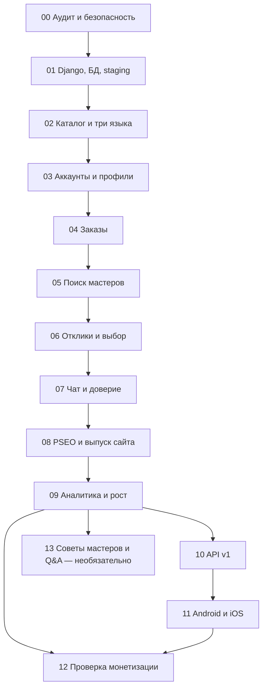

# ZemiPro — дорожная карта разработки и запуска

> **Версия:** 1.2.0  
> **Базовая дата:** 2026-11-05  
> **Статус:** рабочая дорожная карта, не свидетельство завершения этапов  
> **Горизонт:** бессрочно; без фиксированных дедлайнов  
> **Файл для GitHub:** `docs/ROADMAP.md`  
> **Синхронизировано с:** `docs/TECHNICAL_SPEC.md`, `docs/DEVELOPMENT_PLAN.md`, `docs/MARKETING_STRATEGY.md`  
> **Рынок:** Израиль; три языка `ru/en/he`; веб на Django → Android и iOS

## 1. Цель и неизменные договорённости

Разработать **ZemiPro**, многоязычный универсальный маркетплейс услуг Израиля по механике [Profi.ru](https://profi.ru/): заказчик публикует задачу **или** сам ищет специалиста; мастер откликается; стороны договариваются, ведут переписку, завершают заказ и оставляют честный отзыв. Речь о собственном дизайне, коде и бренде, без копирования материалов Profi.ru.

- **Основа:** уже существующий Django-проект и PostgreSQL, без ненужной переписки с нуля. Старый Telegram-бот и PSEO — источники проверки и переиспользования.
- **Продуктовый охват:** все основные категории услуг с возможностью расширять каталог без изменений ядра; привлечение пользователей начинается с Ашдода и Ашкелона, затем расширяется по подтверждённому спросу.
- **Языки:** русский, английский, иврит; корректный RTL, мультиязычное SEO, возможность AI-перевода с указанием происхождения.
- **Регистрация специалистов:** без обязательной проверки лицензий/сертификатов платформой; не выдавать неподтверждённые статусы. Соблюдение применимого законодательства обязательно.
- **Деньги:** заказчику бесплатно; базовая работа исполнителя бесплатна при запуске; эксперименты с оплатой платформы — после доказанного спроса. ZemiPro не хранит оплату самих услуг в начальной модели.
- **Продвижение:** в первую очередь Facebook и SEO, автоматизация разрешённых операций, без обязательных затрат на рекламу и нежелательных массовых сообщений.
- **Приложения:** Android и iOS работают через общий Django API и ту же PostgreSQL, после стабилизации веб-платформы.

## 2. Исходники и документы — изучать до начала работ

| Приоритет | Источник | Назначение |
|---|---|---|
| 1 | [Текущий Django + старый Telegram-бот](https://github.com/maxim9362/zemiPro_site_django) | Главная кодовая база; `zemipro_web/`, модели, формы, Django-модули, `TECHNICAL_REPORT.md`, `DJANGO_SETUP.md` |
| 2 | [ZemiPro PSEO (приватный)](https://github.com/maxim9362/zemipro_site_pseo) | Регионы, категории, маршруты, Flask-страницы, SEO-контент, `index_site/`, генераторы, актуальные публичные URL |
| 3 | [Публичный ZemiPro](https://zemipro.co.il/) | Живые адреса страниц, редиректы, текущее поведение, индексация |
| 4 | [Profi.ru](https://profi.ru/) | Только референс сценариев, функций и UX: каталог, анкеты, заказы, предложения, чаты, отзывы |
| 5 | `docs/TECHNICAL_SPEC.md` | Источник обязательных продуктовых и технических требований (`REQ-*`) |
| 6 | `docs/DEVELOPMENT_PLAN.md` | Детальные задачи, тесты и критерии каждого из 85 подэтапов |
| 7 | `docs/MARKETING_STRATEGY.md` | Постоянные правила маркетинга, метрики и порядок их изменения |

**Важно:** в старом коде и PSEO обнаружены потенциально чувствительные файлы и секреты. Не переносить `.env`, сервисные ключи и прокси-учётные данные в новые коммиты/логи. Действительные скомпрометированные секреты подлежат ротации. Перед переносом PSEO создать полный реестр URL, данные и индексацию подтверждать фактически. Текущая маркетинговая стратегия ориентирована на бытовые услуги; по мере выхода во все категории корректировать её как отдельный документ, не снижая исходный фокус привлечения.

## 3. Легенда статусов и исходный срез

| Статус | Значение |
|---|---|
| `NOT_STARTED` | Ещё не начинали **работу по новому плану**; старый код может существовать, но готовность не проверена |
| `IN_PROGRESS` | Работа ведётся, DoD ещё не доказан |
| `BLOCKED` | Продолжение невозможно: указать причину и условие разблокировки |
| `REVIEW` | Этапный PR подготовлен; ожидает проверок/решения владельца |
| `DONE` | Критерии, тесты, документация и приёмка подтверждены; этапный PR принят |
| `DEFERRED` | Отложено обоснованным решением, указано влияние на последующие этапы |

**Историческая начальная точка (2026-11-05):** `0/13` этапов и `0/85` подэтапов были подтверждены в новой программе. Это **не** означает отсутствия кода: Django, Telegram и PSEO уже содержат реализованные части. Подэтап можно отметить `DONE` после проверки существующей функции по критериям и тестам, без обязательного переписывания.

**Актуальный объём плана (2026-11-10):** 14 этапов (00–13), 96 подэтапов; **13 — необязательный после-MVP модуль**, начало только после готовности этапа 09 и команды владельца. Исторические отметки не переписываются; этап 01 остаётся `IN_PROGRESS / LOCALLY_VERIFIED`, как зафиксировано в `docs/PROGRESS.md`.

### Сводный статус этапов

| Этап | Наименование | Подэтапов | Зависит от | Начальный статус | PR |
|---|---|---:|---|---|---|
| `00` | Аудит, безопасность и сохранение активов | 6 | Нет | `IN_PROGRESS / STATICALLY_INVENTORIED` | — |
| `01` | Стабилизация Django и инфраструктуры | 6 | 00 | `IN_PROGRESS / LOCALLY_VERIFIED` | [#2](https://github.com/maxim9362/zemiPro_site_django/pull/2) |
| `02` | Категории, география, три языка | 6 | 01 | `NOT_STARTED / UNVERIFIED` | — |
| `03` | Аккаунты, роли и профили | 7 | 02 | `NOT_STARTED / UNVERIFIED` | — |
| `04` | Создание и управление заказами | 7 | 03 | `NOT_STARTED / UNVERIFIED` | — |
| `05` | Поиск специалистов и приглашения | 6 | 04 | `NOT_STARTED / UNVERIFIED` | — |
| `06` | Отклики, предложения и выбор исполнителя | 6 | 05 | `NOT_STARTED / UNVERIFIED` | — |
| `07` | Чат, уведомления, репутация и модерация | 7 | 06 | `NOT_STARTED / UNVERIFIED` | — |
| `08` | Перенос PSEO и публичный запуск Django | 7 | 07 + инвентарь 00 | `NOT_STARTED / UNVERIFIED` | — |
| `09` | Аналитика и автоматизированный маркетинг | 7 | 08 | `NOT_STARTED / UNVERIFIED` | — |
| `10` | Версионированный API для приложений | 6 | 09 (подготовительные контракты можно раньше) | `NOT_STARTED / UNVERIFIED` | — |
| `11` | Мобильное приложение Android и iOS | 7 | 10 | `NOT_STARTED / UNVERIFIED` | — |
| `12` | Монетизация и долгосрочное развитие | 7 | 09 для гипотез; 11 для полного контура | `NOT_STARTED / UNVERIFIED` | — |
| `13` | Статьи, Q&A, рекомендации и приглашения (необязательный) | 11 | 09 + решение владельца; 10–12 независимы | `DEFERRED` | — |
| **Итого** | **14 этапов** | **96** | | **0 этапов закрыто по гейтам** | |

## 4. Порядок и контрольные точки



**Контрольные рубежи (гейты):**

- **G0 — безопасная база (00–01):** аудит, секреты, резервное восстановление, CI/staging; без этого нельзя безопасно менять production.
- **G1 — функциональный маркетплейс (02–07):** оба клиентских сценария, основные функции специалиста, завершение и отзывы, доступность на трёх языках.
- **G2 — публичный Django вместо прежнего сайта (08):** сохранены важные PSEO URL/редиректы, проверены SEO и план отката; **переключение только по разрешению владельца**.
- **G3 — измеряемый рост (09):** реальные заявки, подбор исполнителя, органическая публикация и аналитика эффективности.
- **G4 — стабильный мобильный API (10):** общий API без дублирования бизнес-правил.
- **G5 — приложения (11):** Android/iOS с общими профилями, заказами, сообщениями и проверками.
- **G6 — проверенная коммерческая модель (12):** реальные гипотезы, тесты платежей и управляемое масштабирование; первые исследования монетизации возможны после G3, не дожидаясь приложения.
- **G7 — факультативные знания (13):** после G3 и команды владельца — пилот статей, отдельное решение `GO/NO-GO` для Q&A; не блокирует G4–G6 или первичный релиз.

**Даты:** не задаём вымышленных сроков. Переход происходит после выполнения гейта, а не из-за календаря. При необходимости владелец добавит целевые даты отдельным решением.

## 5. Подробная дорожная карта с 96 подэтапами

**Рабочая отметка:** каждый пункт ниже начинается с `[ ]` и имеет статус `NOT_STARTED / UNVERIFIED`. В ходе разработки обновляются **и** checkbox, **и** карточка `docs/PROGRESS.md`. В `ROADMAP.md` не писать неподтверждённое «готово».

### Этап 00. Аудит, безопасность и сохранение активов

- **Зависимость:** Нет.
- **Результат этапа:** Зафиксированы исходный код, данные, опубликованные SEO-URL; риски раскрытых секретов устранены или отмечены как блокер.
- **Гейт закрытия:** Проверенные резервные копии, матрица reuse/adapt/rewrite, инвентарь URL, результаты безопасных диагностик и решение по секретам.
- **Особое условие:** Критический стоп-фактор: не переходить к деплою или копированию данных без проверки секретов и backup.
- **Статус:** `IN_PROGRESS / STATICALLY_INVENTORIED` · **Ветка:** `stage-00-audit` · **Итоговый PR:** после 00.1–00.6; без merge до разрешения владельца

- [ ] **00.1 — Инвентаризация существующих реализаций.** `IN_PROGRESS / STATICALLY_INVENTORIED`: матрица Django, Telegram и PSEO записана в `docs/STAGE_00_IMPLEMENTATION_INVENTORY.md`, источники/тесты/решения по повторному использованию и неизвестное обозначены. Ожидается независимая сверка и приёмка; не `DONE`.
- [ ] **00.2 — Аварийная проверка и ротация секретов.** `BLOCKED / OWNER_ACTION_REQUIRED`: по метаданным обнаружены отслеживаемые PSEO `.env`, `index_site/service_account.json` и два SQLite `.db`; значения не читались, ротация и сохранение данных не выполнялись. Подготовлен `docs/STAGE_00_SECRET_RISK_REGISTER.md` и безопасный план; для закрытия нужны подтверждение статуса секретов, разрешённая ротация/отзыв и решение о сохранении исторических файлов.
- [ ] **00.3 — Резервные копии и фиксация исходного состояния.** `IN_PROGRESS / RESTORE_NOT_VERIFIED`: созданы безопасная локальная утилита для синтетической PostgreSQL, процедура restore и реестр источников/контрольных значений; реальный backup/restore и контрольные counts ещё `NOT_RUN`. Без подтверждённой репетиции не `DONE`.
- [ ] **00.4 — Инвентаризация опубликованных URL бывшего PSEO.** `IN_PROGRESS / GSC_AND_SITEMAP_UNVERIFIED`: подготовлен `docs/SEO_URL_INVENTORY.csv` (21 проверенный по публичным источникам URL: 11 открыты в веб-инструменте, 10 найдены поиском) и `docs/STAGE_00_URL_AUDIT.md`; полнота sitemap, живые HTTP-коды и GSC пока `UNVERIFIED`. По ADR-0002 Flask/SQLite/тексты не переносим; 301 и отключение публичного сайта запрещены до отдельного разрешения.
- [ ] **00.5 — Архитектурная карта и план переноса.** `IN_PROGRESS / PLAN_PREPARED`: зафиксированы ADR-0003, карта доменных моделей, source-to-target матрица и сценарии dry-run/первого деплоя. По решениям владельца никакого импорта Telegram/PSEO: сохраняем только старые URL для REVIEW. Runtime dry-run и итоговая приёмка — `NOT_RUN`; без проверки не `DONE`.
- [ ] **00.6 — Базовая диагностическая проверка.** Готово когда: контрольная точка с известными багами и красными/зелёными тестами; определён объём этапа 01.

**Решение по этапу 00:** закрывать только после выполненных подэтапов (или документированного `DEFERRED` с подтверждением), адресных проверок, необходимых интеграционных тестов и принятия единственного этапного PR.

### Этап 01. Стабилизация Django и инфраструктуры

- **Зависимость:** 00.
- **Результат этапа:** Воспроизводимые dev/test/staging, PostgreSQL и миграции, CI, наблюдаемость.
- **Гейт закрытия:** Чистая установка и миграции проходят, тесты проверены, staging работает отдельно от production, восстановление БД воспроизводимо.
- **Особое условие:** Обновление production, DNS и исходной БД требует отдельного разрешения.
- **Статус:** `IN_PROGRESS / LOCALLY_VERIFIED` · **Ветка:** `stage-01-backend-security` · **Итоговый PR:** [#2](https://github.com/maxim9362/zemiPro_site_django/pull/2)

- [ ] **01.1 — Структура конфигурации и окружений.** `IN_PROGRESS`: безопасные production defaults и обязательные переменные проверены; полное разделение settings/lock ещё не закрыто. Готово когда: новый разработчик может запустить проект по инструкции, без ручного редактирования исходного кода.
- [ ] **01.2 — PostgreSQL и миграции.** `IN_PROGRESS`: владелец заявки закреплён на уровне схемы, миграция чистой и текущей dev-БД проверена; полный legacy-план остаётся. Готово когда: `migrate` повторяем, схема валидна, без незапланированной потери строк.
- [ ] **01.3 — Базовые тесты и CI.** `IN_PROGRESS`: локально пройдены 17 Django-тестов, включая auth, IDOR/PII, запрет self-response и конкурентный выбор исполнителя на PostgreSQL; CI ещё не добавлен. Готово когда: CI воспроизводим, падающий тест блокирует объединение этапного PR.
- [ ] **01.4 — Docker Compose и staging.** Готово когда: система перезапускается, сохраняет БД и медиа, staging доступен по HTTPS при подключённом домене.
- [ ] **01.5 — Логи, резервное копирование и восстановление.** Готово когда: можно восстановить данные в отдельном окружении; failure виден по мониторингу.
- [ ] **01.6 — Базовая производительность и доступность.** `IN_PROGRESS`: устранены HTTP 500 каталога и нестабильная сортировка доступных заказов; полный замер производительности ещё не выполнен. Готово когда: задокументированные базовые показатели и отсутствие очевидных blocker-багов.

**Решение по этапу 01:** закрывать только после выполненных подэтапов (или документированного `DEFERRED` с подтверждением), адресных проверок, необходимых интеграционных тестов и принятия единственного этапного PR.

### Этап 02. Категории, география, три языка

- **Зависимость:** 01.
- **Результат этапа:** Единый каталог всех основных направлений услуг, города Израиля, RU/EN/HE и RTL.
- **Гейт закрытия:** Идемпотентный импорт, 3 языка во всех критичных каталогах, корректные мобильные RTL-экраны и предсказуемые slugs.
- **Особое условие:** Не путать доступность всех категорий в продукте с одновременным продвижением всех категорий.
- **Статус:** `NOT_STARTED / UNVERIFIED` · **Ветка:** `stage-02-<slug>` · **Итоговый PR:** —

- [ ] **02.1 — Слияние категорий Django, Telegram и PSEO.** Готово когда: все согласованные крупные направления услуг представлены; повторный импорт не дублирует категории.
- [ ] **02.2 — География Израиля и зоны обслуживания.** Готово когда: выбор города работает без «свободного текста» как единственного идентификатора; поиск и ссылки опираются на устойчивые ID.
- [ ] **02.3 — Интернационализация сайта и RTL.** Готово когда: ключевые страницы на `ru/en/he` не содержат непереведённых системных элементов и не ломаются на мобильном экране.
- [ ] **02.4 — Локализованные публичные маршруты каталога.** Готово когда: одинаковая услуга доступна на трёх языках и использует один доменный ID.
- [ ] **02.5 — Конструктор уточняющих вопросов для услуг.** Готово когда: администратор может изменить порядок/варианты вопросов без изменения Python-кода; старые заявки сохраняют смысл ответа.
- [ ] **02.6 — Тесты импорта и локализации.** Готово когда: нет потери идентификаторов, импорт идемпотентен, 3 языка проходят проверки.

**Решение по этапу 02:** закрывать только после выполненных подэтапов (или документированного `DEFERRED` с подтверждением), адресных проверок, необходимых интеграционных тестов и принятия единственного этапного PR.

### Этап 03. Аккаунты, роли и профили

- **Зависимость:** 02.
- **Результат этапа:** Один аккаунт для заказчика и мастера, карточки, портфолио, управляемая приватность.
- **Гейт закрытия:** Регистрация и подтверждение контактов, 2 роли, профиль мастера и клиента, тесты объектных прав доступа.
- **Особое условие:** Нет обязательной проверки профессиональных лицензий; непроверенные профили не получают ложный бейдж проверки.
- **Статус:** `NOT_STARTED / UNVERIFIED` · **Ветка:** `stage-03-<slug>` · **Итоговый PR:** —

- [ ] **03.1 — Единый пользователь и разделение ролей.** Готово когда: переключение ролей не требует второй регистрации; разграничение доступа не зависит от доверия к фронтенду.
- [ ] **03.2 — Регистрация, вход и подтверждение контактов.** Готово когда: нельзя захватить аккаунт через невалидированный номер/email; неавторизованные действия блокируются.
- [ ] **03.3 — Кабинет заказчика и настройки приватности.** Готово когда: владелец видит/меняет свои данные, другой пользователь не получает их через UI/API.
- [ ] **03.4 — Профиль специалиста и компании.** Готово когда: мастер может сохранить и опубликовать заполненную анкету, которую клиент находит в каталоге.
- [ ] **03.5 — Портфолио и медиа.** Готово когда: некорректные файлы отклоняются, внешние пользователи не получают закрытые вложения.
- [ ] **03.6 — Права, аудит и политика блокировок.** Готово когда: negative tests для чужих профилей, блокировок, смены роли и удаления данных.
- [ ] **03.7 — Необязательная связь с Telegram.** Готово когда: привязка/отвязка безопасна, основной сайт работает без Telegram.

**Решение по этапу 03:** закрывать только после выполненных подэтапов (или документированного `DEFERRED` с подтверждением), адресных проверок, необходимых интеграционных тестов и принятия единственного этапного PR.

### Этап 04. Создание и управление заказами

- **Зависимость:** 03.
- **Результат этапа:** Многошаговая заявка для любой категории, гостевой сценарий, приватные данные и полный цикл до выбора.
- **Гейт закрытия:** Проверено создание, восстановление, редактирование и отмена заявок на 3 языках; нет утечек адресов и контактов.
- **Особое условие:** Гостевая заявка должна иметь безопасный способ подтверждения владельца.
- **Статус:** `NOT_STARTED / UNVERIFIED` · **Ветка:** `stage-04-<slug>` · **Итоговый PR:** —

- [ ] **04.1 — Доменная модель заявки и переходы статусов.** Готово когда: недопустимый переход отклоняется, повторный запрос не создаёт лишних событий.
- [ ] **04.2 — Пошаговый мастер создания заказа.** Готово когда: три разных направления услуг создают корректные заявки на всех языках.
- [ ] **04.3 — Гостевая заявка и владение ею.** Готово когда: гость может отредактировать/отменить свою заявку, чужой человек не может.
- [ ] **04.4 — Цена, дата, место и вложения.** Готово когда: список заказов не содержит приватных полей; вложения выдаются по правам.
- [ ] **04.5 — Управление заказом.** Готово когда: заказ не исчезает при перезапуске, статусы и история последовательны.
- [ ] **04.6 — Конкурентность, лимиты и антиспам.** Готово когда: нет задвоенных заказов и утечек данных.
- [ ] **04.7 — События для уведомлений и аналитики.** Готово когда: события воспроизводимы в тестовой среде, повтор не отправляет дубль.

**Решение по этапу 04:** закрывать только после выполненных подэтапов (или документированного `DEFERRED` с подтверждением), адресных проверок, необходимых интеграционных тестов и принятия единственного этапного PR.

### Этап 05. Поиск специалистов и приглашения

- **Зависимость:** 04.
- **Результат этапа:** Поиск мастеров по услугам, району, языку и доступности плюс прямое приглашение.
- **Гейт закрытия:** Работают фильтрация, пагинация, избранное, приглашения, корректные пустые состояния и права доступа.
- **Особое условие:** Онлайн-услуги и локальные услуги должны корректно различаться в геофильтрах.
- **Статус:** `NOT_STARTED / UNVERIFIED` · **Ветка:** `stage-05-<slug>` · **Итоговый PR:** —

- [ ] **05.1 — Поиск и фильтры.** Готово когда: ключевые комбинации фильтров дают предсказуемые результаты и корректную пагинацию.
- [ ] **05.2 — Совпадение географии и видов услуг.** Готово когда: мастер, работающий онлайн, находится вне своего города; локальные услуги не предлагаются в неподдерживаемой зоне.
- [ ] **05.3 — Прозрачное ранжирование.** Готово когда: тесты на предсказуемые сортировки и отсутствие неподтверждённых данных.
- [ ] **05.4 — Приглашение выбранного специалиста.** Готово когда: обе стороны видят статус приглашения, повторное нажатие не создаёт множество приглашений.
- [ ] **05.5 — Публичные анкеты, избранное и пустые состояния.** Готово когда: нет фальшивых карточек, просроченных приглашений и приватных контактов в публичных метаданных.
- [ ] **05.6 — Скорость и UX поиска.** Готово когда: фиксируется измеряемый baseline, у фильтров корректные пустые и ошибочные состояния.

**Решение по этапу 05:** закрывать только после выполненных подэтапов (или документированного `DEFERRED` с подтверждением), адресных проверок, необходимых интеграционных тестов и принятия единственного этапного PR.

### Этап 06. Отклики, предложения и выбор исполнителя

- **Зависимость:** 05.
- **Результат этапа:** Мастер присылает цену/условия, клиент сравнивает предложения и выбирает одного исполнителя.
- **Гейт закрытия:** Состояния заказов консистентны, конкурентное назначение одного исполнителя доказано тестами.
- **Особое условие:** Повторные запросы не должны создавать двойные предложения или назначения.
- **Статус:** `NOT_STARTED / UNVERIFIED` · **Ветка:** `stage-06-<slug>` · **Итоговый PR:** —

- [ ] **06.1 — Модель предложения и история изменений.** Готово когда: невозможно создать дубли активных откликов или подменить чужую цену.
- [ ] **06.2 — Кабинет клиента и сравнение предложений.** Готово когда: клиент видит несколько реальных предложений, но не получает закрытые данные других заказов.
- [ ] **06.3 — Атомарное назначение специалиста.** Готово когда: concurrency test доказывает, что два исполнителя не назначаются одновременно.
- [ ] **06.4 — Фиксация договорённостей.** Готово когда: обе стороны видят согласованную версию условий, журнал позволяет восстановить изменения.
- [ ] **06.5 — Исполнение, завершение и спорные случаи.** Готово когда: завершение доступно только уполномоченным сторонам и корректно открывает возможность отзыва.
- [ ] **06.6 — Антифрод и аудит событий заказа.** Готово когда: тесты права доступа, идемпотентности и последовательности событий прошли.

**Решение по этапу 06:** закрывать только после выполненных подэтапов (или документированного `DEFERRED` с подтверждением), адресных проверок, необходимых интеграционных тестов и принятия единственного этапного PR.

### Этап 07. Чат, уведомления, репутация и модерация

- **Зависимость:** 06.
- **Результат этапа:** Защищённый чат, события, отзывы по выполненным заказам, жалобы и модерация.
- **Гейт закрытия:** Пройден полный сквозной сценарий заказчик↔мастер и негативные тесты прав, уведомления и AI не блокируют основной сервис.
- **Особое условие:** Оригинал переписки доступен независимо от AI-перевода; Gemini — необязательный компонент.
- **Статус:** `NOT_STARTED / UNVERIFIED` · **Ветка:** `stage-07-<slug>` · **Итоговый PR:** —

- [ ] **07.1 — Диалоги и права доступа.** Готово когда: третье лицо и заблокированный участник не могут читать/отправлять сообщения, в том числе по прямому URL/API.
- [ ] **07.2 — Доставка сообщений и UX чата.** Готово когда: диалог корректно восстанавливается после рестарта/обрыва, нет дублирующих сообщений.
- [ ] **07.3 — Система уведомлений и пользовательские настройки.** Готово когда: событие один раз создаёт ожидаемое уведомление; сбой канала не ломает заказ.
- [ ] **07.4 — Отзывы, ответы и портфель репутации.** Готово когда: нельзя отозваться на чужой/несуществующий заказ, создать накрученные отзывы или изменить рейтинг через API.
- [ ] **07.5 — Жалобы и административная модерация.** Готово когда: жалоба из карточки мастера, заказа и чата поступает модератору и закрывается с зафиксированным исходом.
- [ ] **07.6 — Перевод переписки и AI-подсказки.** Готово когда: кнопка «Показать оригинал» работает, а при недоступности Gemini чат продолжает функционировать.
- [ ] **07.7 — Сквозные E2E-тесты двух ролей.** Готово когда: e2e-чеклист проходит в staging с синтетическими пользователями; критичные баги закрыты.

**Решение по этапу 07:** закрывать только после выполненных подэтапов (или документированного `DEFERRED` с подтверждением), адресных проверок, необходимых интеграционных тестов и принятия единственного этапного PR.

### Этап 08. Перенос PSEO и публичный запуск Django

- **Зависимость:** 07 + инвентарь 00.
- **Результат этапа:** Старые SEO-страницы сохранены либо перенаправлены; Django обслуживает публичный сайт.
- **Гейт закрытия:** Проверены значимые старые URL, 301/canonical/hreflang, готов откат, разрешено переключение домена.
- **Особое условие:** Запрещены массовые 404, случайные редиректы на главную и переключение домена без согласования.
- **Статус:** `NOT_STARTED / UNVERIFIED` · **Ветка:** `stage-08-<slug>` · **Итоговый PR:** —

- [ ] **08.1 — Подтверждение полного списка опубликованных URL.** Готово когда: нет неизвестных массовых шаблонов URL; решение по каждой важной странице документировано.
- [ ] **08.2 — Контролируемый перенос категорий, регионов и контента.** Готово когда: повторный импорт не создаёт дубликаты, нет фиктивных мастеров/отзывов/статистики.
- [ ] **08.3 — SEO-страницы в Django.** Готово когда: страницы не зависят от Flask или SQLite как рабочей базы и не вводят пользователя в заблуждение.
- [ ] **08.4 — Техническое SEO и три языка.** Готово когда: для репрезентативной выборки URL нет конфликтов canonical/hreflang и некорректных schema.org утверждений.
- [ ] **08.5 — Страница-по-странице миграция и редиректы.** Готово когда: тесты на все существенные URL, нулевые критические редирект-циклы и понятный rollback.
- [ ] **08.6 — Переход на Django и контроль индексации.** Готово когда: основной домен открывает Django-продукт; legacy SEO-доступность подтверждена, ошибки мониторятся.
- [ ] **08.7 — Редакционный конвейер нового SEO-контента.** Готово когда: у публикаций есть источник данных, версия, статус ревью и контроль низкоценного контента.

**Решение по этапу 08:** закрывать только после выполненных подэтапов (или документированного `DEFERRED` с подтверждением), адресных проверок, необходимых интеграционных тестов и принятия единственного этапного PR.

### Этап 09. Аналитика и автоматизированный маркетинг

- **Зависимость:** 08.
- **Результат этапа:** Измеряемые воронки, Facebook/SEO, контент-производство, привлечение мастеров и заказчиков.
- **Гейт закрытия:** Аналитика отражает заявки и подбор исполнителей, публикации управляемы, есть лимиты, журнал и аварийное отключение.
- **Особое условие:** Никакого массового спама и обхода правил Meta; 0 ₪ платной рекламы до отдельного решения.
- **Статус:** `NOT_STARTED / UNVERIFIED` · **Ветка:** `stage-09-<slug>` · **Итоговый PR:** —

- [ ] **09.1 — События и воронки.** Готово когда: каждое ключевое событие имеет одно описание и тест; конверсия не удваивается из-за повторов.
- [ ] **09.2 — Маркетинговая панель и контроль качества источников.** Готово когда: администратор видит воронки по языку/городу/категории без раскрытия PII и понимает причину расхождений.
- [ ] **09.3 — Facebook-страница ZemiPro.** Готово когда: тестовый пост публикуется после разрешения, запись о публикации сохраняется, есть кнопка паузы автоматизации.
- [ ] **09.4 — Конвейер изображений и коротких видео.** Готово когда: создан тестовый ролик каждого языка, нет ложных утверждений, логируется публикация и её результат.
- [ ] **09.5 — Привлечение мастеров и заказчиков.** Готово когда: у кампаний есть измеряемый переход к регистрации/заявке и реальная оценка качества лидов.
- [ ] **09.6 — Автоматическая аналитика и адаптация стратегии.** Готово когда: при отключении интеграции нет неконтролируемых публикаций/повторов, каждое изменение стратегии объяснимо.
- [ ] **09.7 — Первый управляемый рост после релиза.** Готово когда: аналитика позволяет различать проблемы предложения, спроса, качества и UX; стратегия обновляется в `MARKETING_STRATEGY.md`.

**Решение по этапу 09:** закрывать только после выполненных подэтапов (или документированного `DEFERRED` с подтверждением), адресных проверок, необходимых интеграционных тестов и принятия единственного этапного PR.

### Этап 10. Версионированный API для приложений

- **Зависимость:** 09 (подготовительные контракты можно раньше).
- **Результат этапа:** Документированный Django REST API v1 с теми же бизнес-правилами, что у сайта.
- **Гейт закрытия:** Мобильный тестовый клиент проходит сценарии профилей, заказа, выбора мастера и чата; OpenAPI и security-check актуальны.
- **Особое условие:** Сайт и приложение не получают отдельные конкурирующие базы или реализацию правил бизнеса.
- **Статус:** `NOT_STARTED / UNVERIFIED` · **Ветка:** `stage-10-<slug>` · **Итоговый PR:** —

- [ ] **10.1 — API-архитектура и авторизация.** Готово когда: права API не слабее прав Django views; OpenAPI генерируется автоматически.
- [ ] **10.2 — Каталог, география и профили через API.** Готово когда: тестовый мобильный клиент получает данные на `ru/en/he` без отдельного API для языка.
- [ ] **10.3 — Заказы, предложения и взаимодействие через API.** Готово когда: одни и те же доменные тесты проходят через веб и API, конкурентное назначение защищено.
- [ ] **10.4 — Контракт, документация и совместимость.** Готово когда: OpenAPI соответствует фактическому поведению и образцам запросов.
- [ ] **10.5 — Безопасность и нагрузочное тестирование.** Готово когда: нет открытых критических уязвимостей, загрузка и типовые операции выдерживают согласованный профиль нагрузки.
- [ ] **10.6 — Релиз API v1.** Готово когда: тестовый API-клиент проходит полный сценарий заказа и чата, контракт опубликован во внутренней документации.

**Решение по этапу 10:** закрывать только после выполненных подэтапов (или документированного `DEFERRED` с подтверждением), адресных проверок, необходимых интеграционных тестов и принятия единственного этапного PR.

### Этап 11. Мобильное приложение Android и iOS

- **Зависимость:** 10.
- **Результат этапа:** Мобильный клиент на общем Django API, локализованный и проверенный на устройствах.
- **Гейт закрытия:** Пройдены ключевые e2e-сценарии, проверены RU/EN/HE и RTL, выпуск одобрен владельцем аккаунтов магазинов.
- **Особое условие:** Flutter/React Native выбирается отдельным ADR, не фиксировать выбор заранее без проверки требований.
- **Статус:** `NOT_STARTED / UNVERIFIED` · **Ветка:** `stage-11-<slug>` · **Итоговый PR:** —

- [ ] **11.1 — Выбор стека и приложение-каркас.** Готово когда: приложение запускается на Android и iOS simulator, подключается к staging API, не содержит секретов.
- [ ] **11.2 — Навигация, дизайн и три языка.** Готово когда: смена языка не теряет ввод и корректно перестраивает интерфейс на иврите.
- [ ] **11.3 — Сценарии заказчика.** Готово когда: заказчик без веба может пройти полный сценарий до выбора и завершения заказа.
- [ ] **11.4 — Сценарии исполнителя.** Готово когда: специалист управляет своими заказами и предложениями без мобильного браузера.
- [ ] **11.5 — Чат, уведомления и глубокие ссылки.** Готово когда: сообщение/статус читаются одинаково в вебе и приложении; push не раскрывает секретные детали на экране блокировки без разрешения.
- [ ] **11.6 — Реальные устройства, стабильность и магазины.** Готово когда: критичные mobile e2e проходят; внешний релиз возможен только с правами владельца соответствующих аккаунтов разработчика.
- [ ] **11.7 — Пошаговый релиз и обратная связь.** Готово когда: приложение использует ту же базу заказов, работоспособность сайта не зависит от успешности мобильного релиза.

**Решение по этапу 11:** закрывать только после выполненных подэтапов (или документированного `DEFERRED` с подтверждением), адресных проверок, необходимых интеграционных тестов и принятия единственного этапного PR.

### Этап 12. Монетизация и долгосрочное развитие

- **Зависимость:** 09 для гипотез; 11 для полного контура.
- **Результат этапа:** Проверенные платные функции, стабильная подписочная модель и масштабируемая эксплуатация.
- **Гейт закрытия:** Показан реальный спрос, одобрена цена, тестовые платежи идемпотентны, free-функции не сломаны, рост обоснован метриками.
- **Особое условие:** Никаких реальных платежей или расходов без подтверждения; клиент оплачивает услуги специалисту напрямую в базовой модели.
- **Статус:** `NOT_STARTED / UNVERIFIED` · **Ветка:** `stage-12-<slug>` · **Итоговый PR:** —

- [ ] **12.1 — Решение о коммерческом запуске на основе данных.** Готово когда: есть документированное решение о тесте платной функции; без решения feature flag остаётся выключенным.
- [ ] **12.2 — Модель тарифов и права доступа.** Готово когда: free-режим сайта работает и после внедрения платных модулей; entitlements проходят тесты.
- [ ] **12.3 — Платежи с провайдером, работающим в Израиле.** Готово когда: безопасный тестовый платёж, отмена и возврат проходят в sandbox, подписанные webhook проверяются.
- [ ] **12.4 — Подписки, вебхуки и финансовая надёжность.** Готово когда: повторный webhook не создаёт двойную оплату и неправильные привилегии, ошибки видны в мониторинге.
- [ ] **12.5 — Эксперименты с предложением и ценой.** Готово когда: каждая гипотеза имеет до запуска метрику успеха и условие отмены.
- [ ] **12.6 — Масштабирование инфраструктуры.** Готово когда: изменения обоснованы измерениями, есть нагрузочные тесты и rollback-план.
- [ ] **12.7 — Операционная автоматизация и контроль качества.** Готово когда: для каждой автоматизации есть владелец, журнал действий, лимиты, критерии эскалации и emergency stop.

**Решение по этапу 12:** закрывать только после выполненных подэтапов (или документированного `DEFERRED` с подтверждением), адресных проверок, необходимых интеграционных тестов и принятия единственного этапного PR.

### Этап 13. Советы, вопросы, рекомендации и приглашения (необязательный)

- **Зависимость:** закрытый этап 09 и отдельная команда владельца; **независим от 10–12**. Статьи до Q&A.
- **Результат:** модерируемые статьи и Q&A, отдельные личные рекомендации, добровольный Facebook-шеринг профилей, приглашения внешних мастеров и публичное «Посоветуйте мастера» только после проверки спроса.
- **Гейт закрытия:** тексты/медиа и права безопасны, RU/EN/HE, RTL, SEO и ссылки проверены; Q&A проходит GO/NO-GO после пилота статей, «Посоветуйте мастера» — отдельный GO после проверки спроса; остальные новые функции либо проверены, либо DEFERRED без фиктивного DONE.
- **Особое условие:** не блокирует MVP, запуск и миграцию SEO, мобильное приложение или монетизацию; не смешивать вопросы с заказами и платными откликами.
- **Статус:** `DEFERRED` до отдельного решения о начале · **Ветка при старте:** `stage-13-knowledge` · **Итоговый PR:** —

- [ ] **13.1 — Аудит существующего контента и доменная модель.** Готово когда: выбраны REUSE/ADAPT/REWRITE и задокументированы сущности, авторство, ревизии, права и безопасные миграции.
- [ ] **13.2 — Черновики статей и модерация.** Готово когда: только автор редактирует свои материалы, а модерация, PII/медиа-фильтры и жалобы проходят тесты.
- [ ] **13.3 — Публичные статьи, локализация и SEO.** Готово когда: проверены RU/EN/HE, RTL, SEO, язык оригинала, безопасность ссылок и профиля.
- [ ] **13.4 — Пилот статей и решение GO/NO-GO для Q&A.** Готово когда: измерены качество, жалобы, модерационная нагрузка, переходы и реальные заявки; владелец зафиксировал решение.
- [ ] **13.5 — Вопросы/ответы: модели и права (после GO).** Готово когда: публичный вопрос не является заказом, ответы бесплатны, антиспам и права работают.
- [ ] **13.6 — Q&A UX и переход в основной каталог (после GO).** Готово когда: фильтры и ответы работают на трёх языках, репутация не подменяет рейтинг по заказам, контактные данные не раскрываются.
- [ ] **13.7 — E2E, безопасность, аналитика и controlled rollout (после GO).** Готово когда: пройдены тесты, есть feature flag, мониторинг, безопасный rollback и отдельное разрешение на production.
- [ ] **13.8 — Личные рекомендации отдельно от отзывов.** Готово когда: реальные авторы рекомендуют по личному опыту, внешние рекомендации ясно маркируются, рейтинг выполненных заказов не подменяется, есть антифрод, модерация и защита PII.
- [ ] **13.9 — Поделиться профилем мастера в Facebook.** Готово когда: добровольный шеринг/копирование безопасной ссылки работает без Facebook Login и автопостинга.
- [ ] **13.10 — «Посоветуйте мастера» после проверки спроса.** Готово когда: отдельные от Q&A и заказов запросы работают с фильтрами, модерацией, антиспамом и отдельным GO владельца.
- [ ] **13.11 — «Пригласить мастера в ZemiPro».** Готово когда: пользователь может поделиться ссылкой регистрации внешнего мастера без импорта контактов, автосообщений и фиктивных профилей.

**Решение по этапу 13:** до разрешения владельца — `DEFERRED`; при `NO-GO` подэтапы 13.5–13.7 остаются отложенными с причиной, а 13.10 требует отдельного решения по спросу. 13.8–13.9 и 13.11 тоже не запускаются без разрешения. Нельзя объявлять функции реализованными только по наличию ТЗ.

## 6. Как начинать этап и когда разрешён параллелизм

1. **Сначала 00.1–00.6.** Проверить всё старое, особенно раскрытые секреты и опубликованные URL. Аудит не даёт разрешения трогать рабочие БД и домен.
2. **01 — техническая опора.** Подготовить надёжное окружение, миграции, тесты и staging. Дальнейшие функции реализуются на этой основе.
3. **02–07 — пользовательский продукт.** Все категории доступны в общей модели; каждый новый критический сценарий тестируется на RU/EN/HE и смартфоне.
4. **08 — миграция PSEO и публичный переход.** SEO-инвентарь нужен ещё с 00; подготовительную работу по соответствиям и шаблонам допустимо делать раньше, но переключение домена только после гейтов 07–08.
5. **09 — рост после готовности продукта.** Схему аналитических событий можно проектировать в 04–07, а систематические автопубликации и рост привязывать к проверенной версии сервиса.
6. **10–11 — мобильное направление.** API-контракты можно формировать раньше, но стабильный API v1 и приложения — после проверки основного веб-цикла.
7. **12 — заработок и масштабирование.** Исследование спроса на платные функции допустимо после этапа 09; полноценные интеграции денег и расширение только с одобрением владельца и объективными метриками.
8. **13 — факультативные знания.** После этапа 09 и разрешения владельца — статьи 13.1–13.4; только после пилота `GO` разрешает Q&A 13.5–13.7. Никакой зависимости 10–12 от 13.

**Допустимый параллелизм:** документация, UX-прототипы, аудит контента, подготовка API-контрактов, улучшение тестов — если не ломают зависимости и не создают конкурирующих изменений одних и тех же файлов. Ввод новых моделей в production, новые массовые публикации и перенос SEO не считаются «безопасным параллелизмом».

## 7. Единые требования к приёмке

Каждый завершённый подэтап обязан иметь:

- Реализованный код **или** доказанное переиспользование существующего кода с указанием модулей.
- Целевые тесты с командой и результатом `PASS/FAIL/NOT_RUN`; для изменений критических потоков — интеграционные и негативные тесты доступа.
- Обновлённый `docs/PROGRESS.md` **после каждого подэтапа**; обновлённый `ROADMAP.md` при смене статуса или зависимости.
- Миграции, фикстуры/seed, схемы и API-контракты — при необходимости, с проверкой rollback и/или restore.
- Проверки приватности, RU/EN/HE, RTL и мобильной адаптивности там, где функция видна пользователю.
- Явные риски, блокеры, необработанные случаи, ограничения внешних API.
- Ссылку на commit и итоговый PR; `DONE` для этапа только после приёмки и merge.

**Безусловные запреты:** непроверенные фиктивные мастера/отзывы, утечки телефонов и адресов, фальшивые бейджи проверки, секреты в Git, запрещённый автоматический постинг, списание денег без разрешения, потеря проиндексированных URL без анализа.

## 8. Публикация на production — отдельный гейт

Даже если 07 завершён, это **не** означает автоматическую готовность к смене домена. До выкладки проверить:

- [ ] Секреты ротированы и не находятся в отслеживаемом коде; `DEBUG=False`, безопасная конфигурация production.
- [ ] Проверены права на профили, заказы, чаты, отзывы, вложения; нет утечек через URL, API или SEO.
- [ ] Полный процесс поиска и создания заказа, получения предложений, выбора мастера, чата и отзыва проходит на RU/EN/HE.
- [ ] Есть проверенный backup/restore, CI, staging, health checks, мониторинг и сценарий отката.
- [ ] Выполнен `SEO_URL_INVENTORY.csv`; важные legacy URL проходят или имеют точные согласованные 301.
- [ ] Проверены title, canonical, hreflang, sitemap, robots, structured data и скорость мобильных страниц.
- [ ] Подготовлены политика приватности, правила сервиса, канал поддержки и обработка жалоб.
- [ ] Владелец явно согласовал production deploy и изменение DNS/маршрутизации.

## 9. Правила работы Codex и GitHub

**Один этап = одна рабочая ветка = один итоговый Pull Request.** Внутри этапа — 6/7 последовательных подэтапов; можно делать промежуточные коммиты, но не отдельные PR на каждый подэтап, если не согласовано исключение.

1. Перед началом читать `AGENTS.md`, актуальное ТЗ, план и текущую дорожную карту; затем только релевантные файлы. **Не проводить полный аудит репозитория заново перед каждым подэтапом.**
2. По каждой функции искать исходную реализацию в Django, старом Telegram-боте и PSEO. Фиксировать `reuse/adapt/rewrite/reject` и причину.
3. Работать по номеру `XX.Y`, не менять последовательность и приоритеты без согласованной редакции roadmap.
4. После **каждого подэтапа** обновлять `docs/PROGRESS.md`; после изменения этапного статуса — `docs/ROADMAP.md`.
5. Проводить целевые тесты во время реализации и интеграционные/полные по обоснованному риску, перед закрытием PR.
6. Не менять выбранную владельцем модель Codex и настройки reasoning автоматически.
7. Не использовать реальные платёжные средства, не менять production, DNS, ключи, массовые сообщения, PR merge без прямого разрешения.
8. Если выявлена ошибка старой части, внести её в issue/backlog и определить, блокирует ли она текущий гейт.

**Минимальная запись о подэтапе в `docs/PROGRESS.md`:** `ID, статус, что изменилось, переиспользование, проверки, миграции, блокеры, commit/PR, дата, следующий шаг`.

**Шаблон короткого задания Codex:**

```text
Проект: ZemiPro, существующий Django-репозиторий.
Работа: этап XX из docs/ROADMAP.md и docs/DEVELOPMENT_PLAN.md.
Используй AGENTS.md и актуальное docs/TECHNICAL_SPEC.md.
Проверь возможность переиспользовать уже созданные Django, Telegram и PSEO модули.
Выполняй подэтапы XX.1–XX.N, после каждого фиксируй тесты и обновляй docs/PROGRESS.md.
Не делай отдельный PR на каждый подэтап: один итоговый PR на этап.
Не трогай production, секреты, рабочую БД, DNS, постинг или платежи без разрешения.
Не меняй мою модель Codex и режим reasoning.
В конце дай PR, фактически выполненные подэтапы, проверки, ограничения и следующий шаг.
```

## 10. Мониторинг продукта и приоритеты после публичного запуска

**Главный результат:** подтверждённые завершённые заказы от реальных заказчиков (скользящие 30 дней), а не число созданных страниц, регистраций или подписчиков.

| Наблюдаемая ситуация | Преимущественное действие | Документ | 
|---|---|---|
| Заявки есть, а подходящих откликов нет | Привлечь мастеров в конкретной категории и городе, улучшить подбор | `MARKETING_STRATEGY.md`, backlog 05/09 |
| Мастера зарегистрированы, но заявок нет | Усилить локальные SEO/Facebook материалы и качество посадочных страниц | `MARKETING_STRATEGY.md` |
| Заявки есть, но выбор исполнителя не происходит | Анализ цен, предложений, чата и удобства сайта | backlog 04–07 |
| Есть трафик, но люди не создают заявки | Проверка каналов, мобильных форм, языка и первого экрана | backlog 04/09 |
| SEO-страницы теряют трафик после переноса | Аудит redirect/canonical/hreflang, поиск 404 и план отката | `SEO_MIGRATION_PLAN.md` |
| Жалобы/спам растут | Ограничение автоматизации, модерация, antifraud и повторная проверка разрешений | backlog 03/07/09 |
| Платные функции не конвертируют | Не масштабировать расходы; проверить предложение и ценность для мастеров | backlog 12 |

**Важное разграничение:** ChatGPT/Codex может создавать и изменять стратегию и инструменты, но расписание публикаций, метрик и ответов работает на сервере/подключённых сервисах при наличии официальных разрешений. Не обещать полностью автономную работу вне настроенного окружения.

## 11. Как обновлять дорожную карту бессрочно

Версионирование:

- **MAJOR:** изменён принцип продукта, архитектура или порядок обязательных гейтов.
- **MINOR:** добавлены/переставлены этапы, подэтапы, принципиальные зависимости, требования к выпуску.
- **PATCH:** уточнение формулировок, ссылок, критериев, статусов, подтверждений без изменения смысла.

Алгоритм изменения: **причина → предложение → затронутые требования и этапы → оценка рисков/миграций/SEO → согласование владельцем → PR → обновление версии и журнала**. Не менять тихо нумерацию завершённых подэтапов; новые требования добавлять с отдельным ID и связями, а не подменять историю.

**Состояние прогресса:** этот файл — текущие статусы, `docs/PROGRESS.md` — подробные доказательства, `docs/DEVELOPMENT_PLAN.md` — подробное ТЗ этапов, `docs/TECHNICAL_SPEC.md` — обязательные требования. Если они расходятся, закрытие этапа приостанавливается до устранения расхождений.

### Форма записи в журнал прогресса

```md
- Дата: YYYY-MM-DD
- Этап / подэтап: XX / XX.Y
- Было → стало: NOT_STARTED → IN_PROGRESS / REVIEW / DONE / BLOCKED
- Проверено: тесты, ссылка на PR, миграции/релиз, acceptance
- Блокеры/риски: ...
- Следующий подэтап: XX.Z
```

### Журнал изменений roadmap

| Дата | Версия | Изменение | Источник решения |
|---|---|---|---|
| 2026-11-05 | 1.0.0 | Первая дорожная карта: 13 этапов, 85 подэтапов, гейты, начальные статусы и процедуры обновления | Утверждённая концепция ZemiPro и поэтапное ТЗ v1.0.0 |
| 2026-11-07 | 1.1.0 | Опциональный этап 13: 7 новых подэтапов, 14 этапов / 92 подэтапа; статьи → пилот → Q&A по `GO/NO-GO` | `REQ-KNOW-001–015`, PR #3; без фактического запуска |
| 2026-11-10 | 1.2.0 | Добавлены 13.8–13.11: личные рекомендации, Facebook-шеринг, запросы рекомендаций, приглашение новых мастеров; итог 14 этапов / 96 подэтапов | `REQ-KNOW-016–023`, только документация |

## 12. Ближайшее подтверждённое действие

**Этап `00`, подэтап `00.1`: аудит и сопоставление реализованного в Django, Telegram и PSEO.** Параллельно в пределах безопасности оценить раскрытые секреты и зафиксировать необходимость их ротации (`00.2`). До завершения аудита — без удаления данных, выкладки новой версии или переадресации существующих SEO-страниц.
